# CÓDIGO BASE DIAGRAMA DE CASO DE USO - ANJO NEXUS

Este documento consolida o código-fonte executável dos diagramas de Casos de Uso do sistema **Anjo Nexus**, abrangendo todos os **54 Casos de Uso (UC-01 a UC-54)** sincronizados 1:1 com o documento de Descrição dos Casos de Uso.

---

## 1. Versão PlantUML

```plantuml
@startuml
left to right direction
skinparam packageStyle rectangle
skinparam shadowed false

skinparam usecase {
    BackgroundColor #F8FAFC
    BorderColor #475569
    ArrowColor #334155
    FontName Arial
    FontSize 11
}

skinparam actor {
    BackgroundColor #EEF2FF
    BorderColor #4F46E5
    FontName Arial
    FontSize 12
}

'==================== ATORES PRIMÁRIOS (ESQUERDA) ====================
actor "Usuário (Geral)" as User
actor "Consultor Padrão" as ConsPadrao
actor "Consultor Administrador" as ConsAdmin
actor "Startup (Cliente)" as StartupActor
actor "Administrador Global (ADM)" as AdmGlobal

'Herança de Atores (Especialização)
User <|-- ConsPadrao
ConsPadrao <|-- ConsAdmin
User <|-- StartupActor
User <|-- AdmGlobal

'==================== ATORES SECUNDÁRIOS / SISTEMAS (DIREITA) ====================
actor "API AbacatePay (v2)" as AbacatePay <<SistemaExterno>>
actor "Roteador Multi-LLM\n(Groq/DeepSeek/Gemini)" as AIRouter <<SistemaExterno>>
actor "APIs Receita Federal\n(BrasilAPI/ReceitaWS)" as ReceitaAPI <<SistemaExterno>>
actor "Servidor SMTP\n(Gmail App Password)" as SmtpServer <<SistemaExterno>>
actor "Motor de Automação\n(Queues/Spiders/Cron)" as CronSystem <<Sistema>>
actor "Canal WhatsApp\n(Mensageria Externa)" as WhatsAppAPI <<SistemaExterno>>

'==================== FRONTEIRA DO SISTEMA ====================
rectangle "Plataforma SaaS B2B — Anjo Nexus" {

    package "Módulo 1: Autenticação, Contas, Planos e Pagamentos" {
        usecase "UC-01: Realizar Pré-Cadastro e\nValidar Disponibilidade de E-mail" as UC01
        usecase "UC-02: Escolher Plano de Assinatura\ne Gerar Cobrança Inicial" as UC02
        usecase "UC-03: Processar Pagamento via\nWebhook e Ativar Assinatura" as UC03
        usecase "UC-04: Realizar Login e\nValidar Status Financeiro" as UC04
        usecase "UC-05: Recuperar e Redefinir\nSenha via Mensagem Eletrônica" as UC05
        usecase "UC-07: Fazer Logoff" as UC07
        usecase "UC-08: Gerenciar Perfil do Consultor\ne Dados da Consultoria" as UC08
        usecase "UC-42: Cancelamento Voluntário de\nConta Ativa e Exclusão Definitiva (LGPD)" as UC42
        usecase "UC-43: Visualizar Plano de Assinatura,\nConsumo de Cotas e Renovar Ciclo Mensal" as UC43
        usecase "UC-44: Mudar Plano de Assinatura\n(Upgrade e Downgrade)" as UC44
        usecase "UC-45: Consultar Janela de Pagamento\nAnterior (Conta Pendente)" as UC45
        usecase "UC-46: Gerar Nova Cobrança ou\nTrocar Plano na Pendência" as UC46
        usecase "UC-47: Cancelar Pagamento Pendente\ne Excluir Conta Inicial" as UC47
        usecase "UC-49: Acessar Portal de Distribuição\nMobile e QR Code" as UC49
        usecase "UC-50: Confirmar E-mail no Cadastro\ne Registrar Aceite LGPD" as UC50
        usecase "UC-51: Notificar Vencimento Próximo\nda Assinatura Mensal" as UC51
        usecase "UC-52: Realizar Pagamento ou Renovação\nde Assinatura via Cartão de Crédito" as UC52
    }

    package "Módulo 2: Gestão de Equipe e Portal White-Label (RBAC)" {
        usecase "UC-35: Visualizar Tabela de\nUsuários Secundários" as UC35
        usecase "UC-36: Criar Perfil de\nAcesso Secundário (RBAC)" as UC36
        usecase "UC-37: Editar Perfil de\nAcesso Secundário" as UC37
        usecase "UC-38: Excluir Perfil de\nAcesso Secundário" as UC38
        usecase "UC-41: Acessar Portal do Cliente\nStartup (White-Label Modo Leitura)" as UC41
        usecase "UC-53: Realizar Login Exclusivo da Startup\nno Portal White-Label" as UC53
    }

    package "Módulo 3: Gestão da Carteira de Startups e CNPJ" {
        usecase "UC-06: Selecionar e Alternar Startup\nem Uso (Seletor de Contexto)" as UC06
        usecase "UC-09: Cadastrar Startup" as UC09
        usecase "UC-10: Gerenciar Perfil da\nStartup (Empresas)" as UC10
        usecase "UC-11: Fazer Busca Automatizada\nde Dados por CNPJ" as UC11
        usecase "UC-12: Configurar Preferências e\nTags de Nicho da Startup" as UC12
        usecase "UC-29: Extrair e Armazenar em Cache\nDados Empresariais da Receita Federal" as UC29
        usecase "UC-48: Ressincronizar Dados da Startup\nsob Demanda com a Receita Federal" as UC48
    }

    package "Módulo 4: Mineração e Central de Editais" {
        usecase "UC-13: Mostrar Editais\n(Listagem Global Centralizada)" as UC13
        usecase "UC-14: Buscar Editais por\nTermos e Palavras-Chave" as UC14
        usecase "UC-15: Filtrar Editais por\nMetadados Combinados" as UC15
        usecase "UC-16: Visualizar Detalhes\nde um Edital" as UC16
        usecase "UC-17: Favoritar Edital por\nStartup Ativa" as UC17
        usecase "UC-18: Visualizar Editais\nFavoritos da Startup" as UC18
        usecase "UC-19: Ir para o Site\nOficial do Edital" as UC19
        usecase "UC-30: Verificar Notificações\nno Painel" as UC30
        usecase "UC-39: Realizar Mineração Automatizada\nde Editais (Nacional e Estadual)" as UC39
    }

    package "Módulo 5: Inteligência Artificial, OCR e Minutas" {
        usecase "UC-20: Inserir ou Revisar PITCH da\nStartup na Geração de Minuta" as UC20
        usecase "UC-21: Gerar Minuta via Roteador\nInteligente Multi-LLM" as UC21
        usecase "UC-22: Editar Minuta Gerada com\nVersionamento Imutável" as UC22
        usecase "UC-23: Exportar Minuta\n(Formatos Word e PDF)" as UC23
        usecase "UC-24: Deletar Minuta\ndo Histórico" as UC24
        usecase "UC-25: Visualizar Histórico e\nVersões de Minutas Geradas" as UC25
        usecase "UC-26: Processar Anexo do\nEdital e Gerar Checklist" as UC26
        usecase "UC-27: Calcular Score de Elegibilidade (%)\ne Notificar Oportunidades (Match)" as UC27
    }

    package "Módulo 6: Pipeline Kanban e Prazos Processuais" {
        usecase "UC-28: Monitorar e Notificar Prazos Críticos\nde Editais e Kanban" as UC28
        usecase "UC-31: Visualizar Quadro\nKANBAN por Startup" as UC31
        usecase "UC-32: Gerenciar e Movimentar\nTickets no KANBAN" as UC32
        usecase "UC-33: Criar Tickets e Definir\nPrazos no KANBAN" as UC33
        usecase "UC-34: Anexar Arquivos e\nCertidões no KANBAN" as UC34
        usecase "UC-54: Integrar e Enviar Alertas\nOperacionais via WhatsApp" as UC54
    }

    package "Módulo 7: Back-Office e Administração Global" {
        usecase "UC-40: Acessar Dashboard Administrativo\nGlobal (Back-Office ADM)" as UC40
    }
}

'==================== ASSOCIAÇÕES DOS ATORES PRIMÁRIOS ====================
'Usuário Geral
User --> UC04
User --> UC07
User --> UC13
User --> UC14
User --> UC15
User --> UC16
User --> UC19
User --> UC30
User --> UC49

'Consultor Administrador (Ações Exclusivas de Titular)
ConsAdmin --> UC01
ConsAdmin --> UC02
ConsAdmin --> UC05
ConsAdmin --> UC08
ConsAdmin --> UC35
ConsAdmin --> UC36
ConsAdmin --> UC37
ConsAdmin --> UC38
ConsAdmin --> UC42
ConsAdmin --> UC43
ConsAdmin --> UC44
ConsAdmin --> UC45
ConsAdmin --> UC46
ConsAdmin --> UC47
ConsAdmin --> UC50
ConsAdmin --> UC51
ConsAdmin --> UC52

'Consultor Padrão (Herdado também pelo Consultor Administrador)
ConsPadrao --> UC06
ConsPadrao --> UC09
ConsPadrao --> UC10
ConsPadrao --> UC11
ConsPadrao --> UC12
ConsPadrao --> UC17
ConsPadrao --> UC18
ConsPadrao --> UC20
ConsPadrao --> UC21
ConsPadrao --> UC22
ConsPadrao --> UC23
ConsPadrao --> UC24
ConsPadrao --> UC25
ConsPadrao --> UC27
ConsPadrao --> UC31
ConsPadrao --> UC32
ConsPadrao --> UC33
ConsPadrao --> UC34
ConsPadrao --> UC48
ConsPadrao --> UC54

'Startup (Cliente)
StartupActor --> UC41
StartupActor --> UC25
StartupActor --> UC31
StartupActor --> UC53

'Administrador Global (ADM)
AdmGlobal --> UC05
AdmGlobal --> UC40

'==================== RELACIONAMENTOS <<include>> e <<extend>> ====================
UC01 ..> UC02 : <<include>>
UC01 ..> UC50 : <<include>>
UC45 .up.> UC04 : <<extend>>\n[pagamento pendente]
UC46 .up.> UC04 : <<extend>>\n[pagamento pendente]
UC47 .up.> UC04 : <<extend>>\n[pagamento pendente]
UC44 .up.> UC43 : <<extend>>
UC51 ..> UC43 : <<extend>>
UC52 ..> UC02 : <<extend>>
UC52 ..> UC43 : <<extend>>
UC53 ..> UC41 : <<include>>
UC09 ..> UC11 : <<extend>>
UC48 ..> UC10 : <<extend>>
UC11 ..> UC29 : <<include>>
UC48 ..> UC29 : <<include>>
UC16 ..> UC26 : <<include>>
UC21 ..> UC20 : <<include>>
UC39 ..> UC26 : <<include>>

'==================== ASSOCIAÇÕES DOS SISTEMAS EXTERNOS ====================
UC02 --> AbacatePay
UC03 <-- AbacatePay
UC43 --> AbacatePay
UC44 --> AbacatePay
UC45 --> AbacatePay
UC46 --> AbacatePay
UC52 --> AbacatePay

UC05 --> SmtpServer
UC50 --> SmtpServer
UC51 --> SmtpServer

UC29 --> ReceitaAPI

UC21 --> AIRouter
UC26 --> AIRouter
UC27 --> AIRouter

CronSystem --> UC26
CronSystem --> UC27
CronSystem --> UC28
CronSystem --> UC39
CronSystem --> UC51
CronSystem --> UC54

UC54 --> WhatsAppAPI
@enduml
```

---

## 2. Versão Mermaid

```mermaid
flowchart LR
%%==================== ESTILOS ====================
classDef actor fill:#EEF2FF,stroke:#4F46E5,stroke-width:2px,color:#1E1B4B,font-weight:bold;
classDef extSystem fill:#FEF3C7,stroke:#D97706,stroke-width:2px,color:#78350F,font-weight:bold;
classDef usecase fill:#F8FAFC,stroke:#475569,stroke-width:1.5px,color:#0F172A;

%%==================== ATORES PRIMÁRIOS ====================
User["👤 Usuário (Geral)"]:::actor
ConsPadrao["👔 Consultor Padrão"]:::actor
ConsAdmin["👑 Consultor Administrador"]:::actor
StartupActor["🚀 Startup (Cliente)"]:::actor
AdmGlobal["🛡️ Administrador Global (ADM)"]:::actor

%% Herança entre Atores
ConsPadrao -->|Herda de| User
ConsAdmin -->|Herda de| ConsPadrao
StartupActor -->|Herda de| User
AdmGlobal -->|Herda de| User

%%==================== SISTEMAS EXTERNOS ====================
AbacatePay["⚙️ API AbacatePay (v2)"]:::extSystem
AIRouter["🧠 Roteador Multi-LLM\n(Groq/DeepSeek/Gemini)"]:::extSystem
ReceitaAPI["🏛️ APIs Receita Federal\n(BrasilAPI/ReceitaWS)"]:::extSystem
SmtpServer["✉️ Servidor SMTP\n(Gmail App Password)"]:::extSystem
CronSystem["⏱️ Motor Assíncrono\n(Queues/Spiders/Cron)"]:::extSystem
WhatsAppAPI["📱 WhatsApp API\n(Mensageria Externa)"]:::extSystem

%%==================== SISTEMA ANJO NEXUS ====================
subgraph Sistema["Plataforma SaaS B2B — Anjo Nexus"]
    direction TB

    subgraph Mod1["Módulo 1: Autenticação, Contas, Planos e Pagamentos"]
        UC01(["UC-01: Realizar Pré-Cadastro e Validar Disponibilidade de E-mail"]):::usecase
        UC02(["UC-02: Escolher Plano de Assinatura e Gerar Cobrança Inicial"]):::usecase
        UC03(["UC-03: Processar Pagamento via Webhook e Ativar Assinatura"]):::usecase
        UC04(["UC-04: Realizar Login e Validar Status Financeiro"]):::usecase
        UC05(["UC-05: Recuperar e Redefinir Senha via Mensagem Eletrônica"]):::usecase
        UC07(["UC-07: Fazer Logoff"]):::usecase
        UC08(["UC-08: Gerenciar Perfil do Consultor e Dados da Consultoria"]):::usecase
        UC42(["UC-42: Cancelamento Voluntário de Conta Ativa e Exclusão Definitiva (LGPD)"]):::usecase
        UC43(["UC-43: Visualizar Plano de Assinatura, Consumo de Cotas e Renovar Ciclo Mensal"]):::usecase
        UC44(["UC-44: Mudar Plano de Assinatura (Upgrade e Downgrade)"]):::usecase
        UC45(["UC-45: Consultar Janela de Pagamento Anterior (Conta Pendente)"]):::usecase
        UC46(["UC-46: Gerar Nova Cobrança ou Trocar Plano na Pendência"]):::usecase
        UC47(["UC-47: Cancelar Pagamento Pendente e Excluir Conta Inicial"]):::usecase
        UC49(["UC-49: Acessar Portal de Distribuição Mobile e QR Code"]):::usecase
        UC50(["UC-50: Confirmar E-mail no Cadastro e Registrar Aceite LGPD"]):::usecase
        UC51(["UC-51: Notificar Vencimento Próximo da Assinatura Mensal"]):::usecase
        UC52(["UC-52: Realizar Pagamento ou Renovação de Assinatura via Cartão de Crédito"]):::usecase
    end

    subgraph Mod2["Módulo 2: Gestão de Equipe e Portal White-Label (RBAC)"]
        UC35(["UC-35: Visualizar Tabela de Usuários Secundários"]):::usecase
        UC36(["UC-36: Criar Perfil de Acesso Secundário (RBAC)"]):::usecase
        UC37(["UC-37: Editar Perfil de Acesso Secundário"]):::usecase
        UC38(["UC-38: Excluir Perfil de Acesso Secundário"]):::usecase
        UC41(["UC-41: Acessar Portal do Cliente Startup (White-Label Modo Leitura)"]):::usecase
        UC53(["UC-53: Realizar Login Exclusivo da Startup no Portal White-Label"]):::usecase
    end

    subgraph Mod3["Módulo 3: Gestão da Carteira de Startups e CNPJ"]
        UC06(["UC-06: Selecionar e Alternar Startup em Uso (Seletor de Contexto)"]):::usecase
        UC09(["UC-09: Cadastrar Startup"]):::usecase
        UC10(["UC-10: Gerenciar Perfil da Startup (Empresas)"]):::usecase
        UC11(["UC-11: Fazer Busca Automatizada de Dados por CNPJ"]):::usecase
        UC12(["UC-12: Configurar Preferências e Tags de Nicho da Startup"]):::usecase
        UC29(["UC-29: Extrair e Armazenar em Cache Dados Empresariais da Receita Federal"]):::usecase
        UC48(["UC-48: Ressincronizar Dados da Startup sob Demanda com a Receita Federal"]):::usecase
    end

    subgraph Mod4["Módulo 4: Mineração e Central de Editais"]
        UC13(["UC-13: Mostrar Editais (Listagem Global Centralizada)"]):::usecase
        UC14(["UC-14: Buscar Editais por Termos e Palavras-Chave"]):::usecase
        UC15(["UC-15: Filtrar Editais por Metadados Combinados"]):::usecase
        UC16(["UC-16: Visualizar Detalhes de um Edital"]):::usecase
        UC17(["UC-17: Favoritar Edital por Startup Ativa"]):::usecase
        UC18(["UC-18: Visualizar Editais Favoritos da Startup"]):::usecase
        UC19(["UC-19: Ir para o Site Oficial do Edital"]):::usecase
        UC30(["UC-30: Verificar Notificações no Painel"]):::usecase
        UC39(["UC-39: Realizar Mineração Automatizada de Editais (Nacional e Estadual)"]):::usecase
    end

    subgraph Mod5["Módulo 5: Inteligência Artificial, OCR e Minutas"]
        UC20(["UC-20: Inserir ou Revisar PITCH da Startup na Geração de Minuta"]):::usecase
        UC21(["UC-21: Gerar Minuta via Roteador Inteligente Multi-LLM"]):::usecase
        UC22(["UC-22: Editar Minuta Gerada com Versionamento Imutável"]):::usecase
        UC23(["UC-23: Exportar Minuta (Formatos Word e PDF)"]):::usecase
        UC24(["UC-24: Deletar Minuta do Histórico"]):::usecase
        UC25(["UC-25: Visualizar Histórico e Versões de Minutas Geradas"]):::usecase
        UC26(["UC-26: Processar Anexo do Edital e Gerar Checklist"]):::usecase
        UC27(["UC-27: Calcular Score de Elegibilidade (%) e Notificar Oportunidades (Match)"]):::usecase
    end

    subgraph Mod6["Módulo 6: Pipeline Kanban e Prazos Processuais"]
        UC28(["UC-28: Monitorar e Notificar Prazos Críticos de Editais e Kanban"]):::usecase
        UC31(["UC-31: Visualizar Quadro KANBAN por Startup"]):::usecase
        UC32(["UC-32: Gerenciar e Movimentar Tickets no KANBAN"]):::usecase
        UC33(["UC-33: Criar Tickets e Definir Prazos no KANBAN"]):::usecase
        UC34(["UC-34: Anexar Arquivos e Certidões no KANBAN"]):::usecase
        UC54(["UC-54: Integrar e Enviar Alertas Operacionais via WhatsApp"]):::usecase
    end

    subgraph Mod7["Módulo 7: Back-Office e Administração Global"]
        UC40(["UC-40: Acessar Dashboard Administrativo Global (Back-Office ADM)"]):::usecase
    end
end

%%==================== LIGAÇÕES DOS ATORES PRIMÁRIOS ====================
User --> UC04 & UC07 & UC13 & UC14 & UC15 & UC16 & UC19 & UC30 & UC49
ConsAdmin --> UC01 & UC02 & UC05 & UC08 & UC35 & UC36 & UC37 & UC38 & UC42 & UC43 & UC44 & UC45 & UC46 & UC47 & UC50 & UC51 & UC52
ConsPadrao --> UC06 & UC09 & UC10 & UC11 & UC12 & UC17 & UC18 & UC20 & UC21 & UC22 & UC23 & UC24 & UC25 & UC27 & UC31 & UC32 & UC33 & UC34 & UC48 & UC54
StartupActor --> UC41 & UC25 & UC31 & UC53
AdmGlobal --> UC05 & UC40

%%==================== RELAÇÕES INCLUDE E EXTEND ====================
UC01 -.include.-> UC02
UC01 -.include.-> UC50
UC45 -.extend[pagamento pendente].-> UC04
UC46 -.extend[pagamento pendente].-> UC04
UC47 -.extend[pagamento pendente].-> UC04
UC44 -.extend.-> UC43
UC51 -.extend.-> UC43
UC52 -.extend.-> UC02
UC52 -.extend.-> UC43
UC53 -.include.-> UC41
UC09 -.extend.-> UC11
UC48 -.extend.-> UC10
UC11 -.include.-> UC29
UC48 -.include.-> UC29
UC16 -.include.-> UC26
UC21 -.include.-> UC20
UC39 -.include.-> UC26

%%==================== LIGAÇÕES DOS SISTEMAS EXTERNOS ====================
UC02 & UC43 & UC44 & UC45 & UC46 & UC52 --> AbacatePay
AbacatePay --> UC03
UC05 & UC50 & UC51 --> SmtpServer
UC29 --> ReceitaAPI
UC21 & UC26 & UC27 --> AIRouter
CronSystem --> UC26 & UC27 & UC28 & UC39 & UC51 & UC54
UC54 --> WhatsAppAPI
```

