# Diagrama Entidade-Relacionamento (DER) Físico e Lógico - Anjo Nexus

Este documento consolida o **Modelo Físico e Lógico de Banco de Dados** da plataforma **Anjo Nexus**, extraído com 100% de conformidade a partir das migrations consolidadas do repositório (`MVPs/Versão Atual/back/database/migrations/`).

---

## 1. Diagrama em Formato Mermaid

```mermaid
erDiagram
    %% ====================================================
    %% 1. NUCLEO MULTI-TENANCY, ASSINATURAS E USUARIOS
    %% ====================================================
    planos {
        bigint id PK
        string nome
        decimal preco
        string id_transacao "nullable"
        int limite_startups
        int limite_membros_equipe
        int limite_minutas_ia
        timestamp created_at
        timestamp updated_at
    }

    agencias {
        bigint id PK
        bigint plano_id FK "nullable"
        string nome
        string id_transacao "nullable"
        text url_checkout "nullable"
        enum status_pagamento "pendente, ativo, suspenso, cancelado"
        timestamp pagamento_expira_em "nullable"
        timestamp assinatura_expira_em "nullable"
        timestamp created_at
        timestamp updated_at
    }

    users {
        bigint id PK
        bigint agencia_id FK "nullable"
        enum perfil_acesso "admin_global, consultor_admin, consultor_padrao, startup"
        string name
        string email UK
        timestamp email_verified_at "nullable"
        string password
        string remember_token "nullable"
        timestamp created_at
        timestamp updated_at
    }

    personal_access_tokens {
        bigint id PK
        string tokenable_type
        bigint tokenable_id FK
        text name
        string token UK
        text abilities "nullable"
        timestamp last_used_at "nullable"
        timestamp expires_at "nullable"
        timestamp created_at
        timestamp updated_at
    }

    password_reset_tokens {
        string email PK,FK
        string token
        timestamp created_at "nullable"
    }

    %% ====================================================
    %% 2. CARTEIRA DE STARTUPS E ENRIQUECIMENTO FISCAL
    %% ====================================================
    startups {
        bigint id PK
        bigint agencia_id FK
        string cnpj "UNIQUE(agencia_id, cnpj)"
        string razao_social
        string nome_fantasia "nullable"
        date data_abertura "nullable"
        string email "nullable"
        string telefone "nullable"
        string cep "nullable"
        string logradouro "nullable"
        string numero "nullable"
        string bairro "nullable"
        string cidade "nullable"
        string estado "nullable"
        string porte "nullable"
        string regime_tributario "nullable"
        string nicho_atuacao "nullable"
        text pitch "nullable"
        timestamp created_at
        timestamp updated_at
    }

    %% ====================================================
    %% 3. EDITAIS DE FOMENTO E METADADOS DE IA
    %% ====================================================
    editals {
        bigint id PK
        string external_id UK "nullable"
        string title
        text source_url "nullable"
        text original_file_path "nullable"
        decimal min_budget "nullable"
        decimal max_budget "nullable"
        datetime deadline "nullable"
        datetime open_date "nullable"
        datetime result_date "nullable"
        datetime published_at "nullable"
        enum status "active, closed"
        boolean ai_analyzed
        int ai_match "nullable"
        string ai_trl "nullable"
        string ai_faturamento "nullable"
        string ai_nicho "nullable"
        json ai_diagnosis "nullable"
        text objetivo "nullable"
        longtext conteudo_completo "nullable"
        string condicao_financiamento "nullable"
        string operacao "nullable"
        string publico "nullable"
        string fonte
        json documentos "nullable"
        string regiao "nullable"
        string nicho_tema "nullable"
        timestamp created_at
        timestamp updated_at
    }

    %% ====================================================
    %% 4. FAVORITOS E SISTEMA DE ALERTAS (MATCH E PRAZOS)
    %% ====================================================
    edital_favoritos {
        bigint id PK
        bigint user_id FK
        bigint edital_id FK
        bigint startup_id FK "nullable"
        timestamp created_at
        timestamp updated_at
    }

    alerta_matches {
        bigint id PK
        bigint user_id FK
        bigint startup_id FK
        bigint edital_id FK
        int score_match
        string titulo
        text mensagem
        json criterios "nullable"
        boolean lido
        timestamp created_at
        timestamp updated_at
    }

    alerta_prazos {
        bigint id PK
        bigint user_id FK
        bigint startup_id FK "nullable"
        bigint edital_id FK
        bigint kanban_card_id FK "nullable"
        string tipo_prazo
        datetime data_limite
        int dias_restantes
        string nivel_urgencia
        string titulo
        text mensagem
        boolean lido
        boolean email_enviado
        datetime email_enviado_em "nullable"
        timestamp created_at
        timestamp updated_at
    }

    %% ====================================================
    %% 5. PIPELINE KANBAN DE PROCESSO
    %% ====================================================
    kanban_boards {
        bigint id PK
        bigint agencia_id FK "nullable"
        string title
        timestamp created_at
        timestamp updated_at
    }

    kanban_columns {
        bigint id PK
        bigint board_id FK
        string title
        double position
        string slug "nullable"
        timestamp created_at
        timestamp updated_at
    }

    kanban_cards {
        bigint id PK
        bigint board_id FK
        bigint column_id FK
        bigint edital_id FK "nullable"
        string title
        text description "nullable"
        string startup_name "nullable"
        double position
        json metadata "nullable"
        timestamp created_at
        timestamp updated_at
    }

    %% ====================================================
    %% 6. MINUTAS TECNICAS E VERSIONAMENTO IMUTAVEL
    %% ====================================================
    minutas {
        bigint id PK
        bigint startup_id FK
        bigint edital_id FK
        bigint user_id FK "nullable"
        bigint kanban_card_id FK "nullable"
        bigint parent_minuta_id FK "nullable"
        int versao
        string titulo_projeto "nullable"
        text ideia_projeto "nullable"
        longtext conteudo_gerado
        json secoes_estruturadas "nullable"
        string status
        string modelo_ia_usado "nullable"
        string autor_nome "nullable"
        timestamp created_at
        timestamp updated_at
    }

    %% ====================================================
    %% RELACIONAMENTOS FISICOS (CARDINALIDADES E INTEGRIDADE)
    %% ====================================================
    planos ||--o{ agencias : "assina"
    agencias ||--o{ users : "possui_membros"
    agencias ||--o{ startups : "gerencia"
    agencias ||--o{ kanban_boards : "possui_quadro"

    users ||--o{ personal_access_tokens : "autentica"
    users ||--o{ password_reset_tokens : "recupera"

    kanban_boards ||--o{ kanban_columns : "contem"
    kanban_columns ||--o{ kanban_cards : "organiza"
    kanban_boards ||--o{ kanban_cards : "agrupa"
    editals |o--o{ kanban_cards : "vinculado_a"

    users ||--o{ edital_favoritos : "favorita"
    editals ||--o{ edital_favoritos : "favoritado_em"
    startups |o--o{ edital_favoritos : "contexto_de"

    users ||--o{ alerta_matches : "notificado_em"
    startups ||--o{ alerta_matches : "referente_a"
    editals ||--o{ alerta_matches : "gerado_por"

    users ||--o{ alerta_prazos : "notificado_em"
    startups |o--o{ alerta_prazos : "vinculado_a"
    editals ||--o{ alerta_prazos : "prazo_de"
    kanban_cards |o--o{ alerta_prazos : "etapa_de"

    startups ||--o{ minutas : "proponente"
    editals ||--o{ minutas : "baseado_em"
    users |o--o{ minutas : "elaborado_por"
    kanban_cards |o--o{ minutas : "associado_a"
    minutas |o--o{ minutas : "versao_anterior"

```

---

## 2. Dicionário das Tabelas Físicas

### 2.1 Núcleo de Faturamento e Multi-Tenancy
* **`planos`**: Tabela mestre dos planos SaaS contratáveis (`Standard`, `Pro` e `Enterprise`). Contém precificação e cotas operacionais (`limite_startups`, `limite_membros_equipe`, `limite_minutas_ia`).
* **`agencias`**: Entidade Tenant raiz. Representa a agência de consultoria. Armazena o vínculo com o plano, a referência de cobrança do gateway (`id_transacao`, `url_checkout`), status (`pendente`, `ativo`, `suspenso`, `cancelado`) e datas de expiração da cobrança e da assinatura mensal de 30 dias.
* **`users`**: Usuários da plataforma segregados por Tenant (`agencia_id`). Controlados pelo enum de RBAC `perfil_acesso` (`admin_global`, `consultor_admin`, `consultor_padrao`, `startup`).
* **`personal_access_tokens`**: Tokens de sessão segura Bearer (Laravel Sanctum) emitidos para autenticação de APIs.
* **`password_reset_tokens`**: Registros temporários de recuperação de credenciais com expiração e vínculo com o e-mail do usuário.

### 2.2 Carteira de Startups
* **`startups`**: Empresas clientes atendidas pela agência de consultoria (`agencia_id`). Possui constraint de unicidade composta `UNIQUE(agencia_id, cnpj)`, permitindo que múltiplas consultorias atendam a mesma empresa sem colisão de dados no ecossistema multi-tenant. Contém campos cadastrais completos, CNAE, porte, regime tributário e apresentação institucional (`pitch`).

### 2.3 Editais de Fomento e Inteligência Artificial
* **`editals`**: Editais públicos e privados minerados de forma autônoma de portais federais e estaduais (FINEP e 9 FAPs estaduais). Contém metadados de elegibilidade, teto orçamentário, cronogramas, checklist de documentação exigida em JSON e campos pré-processados por IA (`ai_analyzed`, `ai_match`, `ai_diagnosis`), garantindo **custo zero de IA** na listagem e triagem rápida.

### 2.4 Favoritos e Central de Alertas
* **`edital_favoritos`**: Associação de interesse de editais realizada por um usuário, vinculada opcionalmente ao contexto de uma startup da carteira (`startup_id`).
* **`alerta_matches`**: Notificações persistidas quando o Score de Elegibilidade atinge patamar satisfatório ($\ge 70\%$). Possui índice único composto `UNIQUE(user_id, startup_id, edital_id)` para garantir idempotência contra alertas duplicados.
* **`alerta_prazos`**: Notificações escalonadas de datas limites (Atenção, Urgente, Crítico em 72h e 24h). Possui constraint `UNIQUE(user_id, edital_id, nivel_urgencia)` evitando disparos redundantes.

### 2.5 Pipeline Kanban e Minutas
* **`kanban_boards`**: Quadros Kanban vinculados à agência (`agencia_id`).
* **`kanban_columns`**: As etapas do pipeline de fomento (`position double`, `slug`), incluindo as 6 colunas oficiais.
* **`kanban_cards`**: Cartões de processo tramitados no quadro. Armazena vinculação opcional a editais, ordenação fracionária contínua (`position double`), nome da startup e metadados flexíveis em JSON (anexos comprobatórios de até 10 MB, notas e valor estimado do projeto).
* **`minutas`**: Propostas técnicas de subvenção econômica geradas pela cascata Multi-LLM ou redigidas manualmente. Implementa auto-relacionamento (`parent_minuta_id`) para versionamento encadeado imutável (`versao`), preservando autor, modelo utilizado e histórico sem consumo repetido de cotas.
