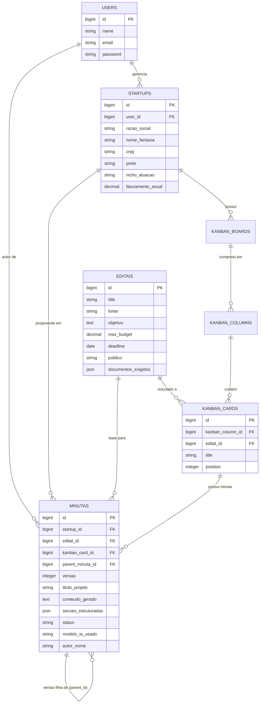
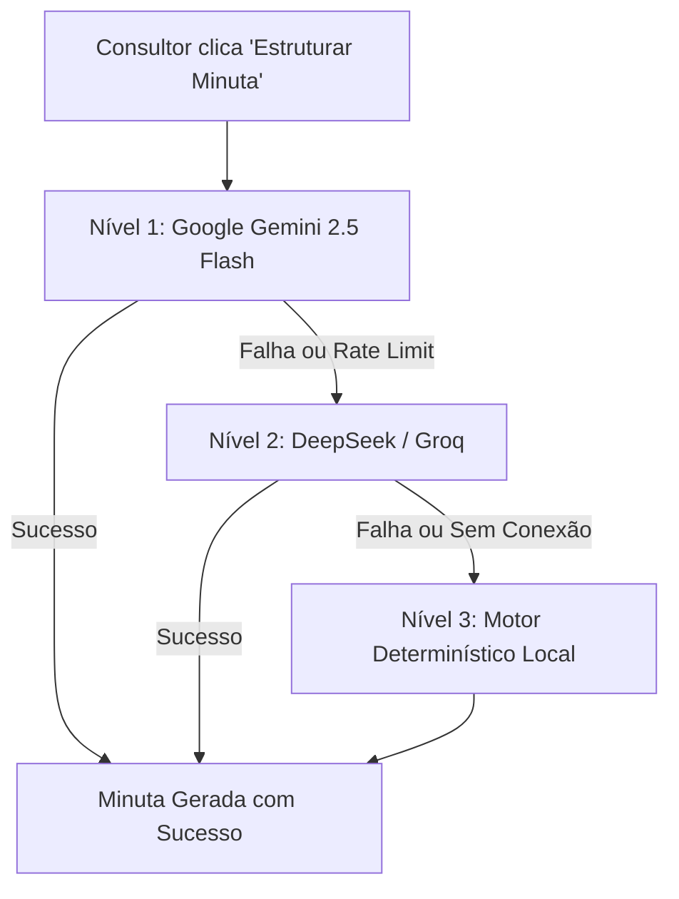

# 🎓 Manual Definitivo de Estudo para Banca Avaliadora
## Anjo Nexus — Radar Inteligente de Editais e Plataforma de Subvenção à Inovação

> **Finalidade do Documento:**  
> Este manual foi estruturado especificamente para a **defesa acadêmica perante a Banca Examinadora do TCC / Projeto Integrador**.  
> Ele sintetiza todos os artefatos de engenharia de software (diagramas UML, casos de uso, requisitos, DER), os 15 Registros de Decisões Arquiteturais (ADRs), as escolhas de stack técnica, as justificativas acadêmicas de projeto e o passo a passo detalhado do código-fonte (Backend Laravel 12, Frontend Vanilla JS e Mobile Capacitor 7).

---

## 📌 Sumário Executivo para Apresentação
1. [A Visão Geral do Produto (O Problema e a Solução)](#1-a-visão-geral-do-produto)
2. [Arquitetura Geral do Sistema e Princípios Adotados](#2-arquitetura-geral-do-sistema)
3. [Decisões Arquiteturais Fundamentais (Matriz de ADRs)](#3-decisões-arquiteturais-fundamentais-matriz-de-adrs)
4. [Engenharia de Dados e Modelagem (DER e Classes)](#4-engenharia-de-dados-e-modelagem)
5. [Módulo a Módulo: Explicação Didática e Defesa de Código](#5-módulo-a-módulo-explicação-de-código)
   - 5.1. [Autenticação e Assinatura de Planos (SaaS)](#51-autenticação-e-assinatura-de-planos)
   - 5.2. [Motor de Web Scraping Híbrido com Custo Zero de IA: Arquitetura e Código](#52-motor-de-web-scraping-híbrido)
   - 5.3. [Extração e Processamento de PDFs de Editais](#53-extração-e-processamento-de-pdfs)
   - 5.4. [Esteira Kanban e Gestão do Pipeline de Submissão](#54-esteira-kanban-e-pipeline)
   - 5.5. [Módulo de IA: Diagnóstico de Aderência (Match RF-47) e Minutas Técnicas (RF-29 a RF-34)](#55-módulo-de-ia-match-e-minutas)
   - 5.6. [Motor Nativo de Exportação OpenXML (.docx) e PDF](#56-motor-nativo-de-exportação-openxml-e-pdf)
   - 5.7. [Frontend Desacoplado: Vanilla JS e Design System](#57-frontend-desacoplado-vanilla-js)
   - 5.8. [Módulo Mobile Híbrido (Capacitor 7), Ergonomia e Esteira CI/CD](#58-módulo-mobile-híbrido-capacitor-7-ergonomia-e-esteira-cicd)
6. [Simulador de Perguntas & Respostas da Banca (Q&A de Arguição)](#6-simulador-de-perguntas-e-respostas-da-banca)
7. [Glossário e Nomenclatura para Argumentação](#7-glossário-técnico-para-a-banca)

---

## 1. A Visão Geral do Produto

### 1.1 O Problema Real de Mercado
Empresas de base tecnológica (Startups, Micro e Pequenas Empresas - MPEs) perdem anualmente milhões de reais em recursos de subvenção econômica não reembolsável (FAPESC, FINEP, FAPESP, CNPq). Os principais gargalos são:
1. **Dispersão e Assimetria de Informações:** Editais publicados em diários oficiais e portais isolados com layouts heterogêneos.
2. **Incerteza de Elegibilidade:** Editais possuem centenas de páginas em PDF; a leitura manual para verificar requisitos de porte, faturamento e TRL (Nível de Maturidade Tecnológica) consome dias de consultoria.
3. **Barreira Técnica na Elaboração da Proposta:** A montagem do Plano de Trabalho exige jargão técnico (ODS, TRL, matriz de riscos, plano de aplicação de recursos) que founders técnicos muitas vezes não dominam.

### 1.2 A Solução Anjo Nexus
Uma plataforma SaaS B2B que atua como **Radar Contínuo e Co-Piloto de Submissão**:
- Raspa e unifica oportunidades governamentais diariamente.
- Avalia a compatibilidade da startup com o edital (**Match Inteligente**).
- Gerencia o ciclo de vida da oportunidade através de um **Pipeline Kanban interativo**.
- Gera automaticamente **Minutas de Proposta estruturadas em 11 seções oficiais**, permitindo edição, versionamento e exportação para Word (.docx) e PDF.

---

## 2. Arquitetura Geral do Sistema

A arquitetura do Anjo Nexus foi concebida sob o paradigma **API-First e Arquitetura Desacoplada (Stateless RESTful)**.

```
┌────────────────────────────────────────────────────────────────────────┐
│                        ARQUITETURA GERAL DO SISTEMA                    │
└────────────────────────────────────────────────────────────────────────┘

    [ CLIENTE: NAVEGADOR WEB ]
          │  HTML5 + Vanilla CSS + JavaScript Puro (SPA Leve)
          │  Zero build-tools, fetch API nativa, manipulação limpa do DOM
          ▼
    [ PROTOCOLO HTTP/REST (JSON) ] (Header: Authorization Bearer Token)
          │
          ▼
┌────────────────────────────────────────────────────────────────────────┐
│               BACKEND: LARAVEL 12 (API RESTful STATELESS)              │
├────────────────────────────────────────────────────────────────────────┤
│  routes/api.php                                                        │
│    └── Middleware (Sanctum / Token Guard / CORS)                       │
│          └── Controllers (Validação via Form Request / Injeção de Dep.)│
│                │                                                       │
│                ├──> Services Layer (Regras de Negócio e Algoritmos)    │
│                │      ├── MinutaAiService (Prompt 11 Seções + Fallback)│
│                │      ├── DocumentExportService (OpenXML .docx / PDF)  │
│                │      ├── KanbanService & CardMovementService          │
│                │      ├── AbacatePayService (Billing / Pix)            │
│                │      └── PdfExtractorService (Regex + smalot/pdfparser│
│                │                                                       │
│                ├──> Spiders Layer (Web Scraping Contínuo)              │
│                │      ├── FinepSpider (Browsershot / Headless Chrome)  │
│                │      ├── FapespSpider (RoachPHP + XPath DOM)          │
│                │      └── FapeScSpider (RoachPHP + XPath DOM)          │
│                │                                                       │
│                └──> Models Eloquent (Mapeamento Objeto-Relacional)     │
│                       ├── User, Startup, Edital, Agencia               │
│                       ├── KanbanBoard, KanbanColumn, KanbanCard        │
│                       └── Minuta (Árvore de Versões e Auditoria)       │
└────────────────────────────────────────────────────────────────────────┘
          │
          ▼
    [ BANCO DE DADOS RELACIONAL: PostgreSQL / MySQL / SQLite ]
```

### Princípios de Engenharia de Software Aplicados:
1. **Single Responsibility Principle (SRP):** Controllers apenas recebem a requisição e devolvem respostas JSON; toda a inteligência reside nas classes de `Services`.
2. **Dependency Injection (DI):** Injeção de dependências nativa do container do Laravel para serviços externos e modelos.
3. **Loose Coupling (Baixo Acoplamento):** O Frontend não conhece detalhes internos do banco de dados, comunicando-se estritamente através de contratos JSON documentados.
4. **Fault Tolerance (Tolerância a Falhas):** Política de contingência multinível na IA (Gemini ➔ DeepSeek ➔ Motor Determinístico Local), garantindo quase 100% de disponibilidade.

---

## 3. Decisões Arquiteturais Fundamentais (Matriz de ADRs)

A banca avaliadora valoriza intensamente a justificativa do **porquê** as decisões foram tomadas. A tabela abaixo resume os 15 Registros de Decisões Arquiteturais (ADRs):

| ADR | Decisão Tomada | Alternativa Rejeitada | Justificativa Acadêmica para a Banca |
| :--- | :--- | :--- | :--- |
| **001** | Backend Laravel API + Frontend Vanilla JS | Aplicação Monolítica com Laravel Blade | Desacoplamento estrito, separação clara de responsabilidades e independência de deploy. |
| **002** | Processamento Background (Queues) para PDFs | Processamento síncrono no request HTTP | Evita estouro de timeout (30s) e travamento de thread HTTP na leitura de PDFs com mais de 50 páginas. |
| **003** | Estratégia Custo Zero de IA no Pipeline | Uso de LLMs para ler todo HTML de editais | Viabilidade financeira. Usar IA em raspagem de 500 editais geraria custos proibitivos e imprevisíveis. |
| **004** | Laravel PHP para Web Scraping | Microserviço isolado em Python (Scrapy) | Redução de complexidade operacional e overhead de infraestrutura: mantém toda a equipe em uma única linguagem backend. |
| **005** | Trade-off de Scraping: APIs Internas + XPath | Raspagem puramente visual baseada em Regex | APIs internas e árvores XPath são imunes a pequenas alterações de cores, margens e layouts CSS. |
| **006** | Extração de PDF determinística (Regex estruturado) | OCR por Visão Computacional / IA | Editais públicos são PDFs digitais pesquisáveis (com texto vetorizado); OCR adicionaria lentidão desnecessária. |
| **007** | Rotação Dinâmica de Chaves de API (`getRandomKey`) | Chave única estática no `.env` | Contorna os limites de requisições por minuto (*Rate Limits*) em camadas gratuitas de LLMs. |
| **008** | Browsershot (Headless Chrome) para FINEP | cURL simples / GuzzleHTTP | O portal da FINEP é uma Single Page Application baseada em Liferay que exige execução de motor JavaScript. |
| **009** | XPath DOM para FAPESP e FAPESC | Quebra de strings (`explode('\n')`) | XPath navega semanticamente na árvore XML/HTML sem quebrar se uma linha em branco for adicionada. |
| **010** | Vanilla JS no Frontend (Fase 1) | Frameworks pesados (React, Angular, Vue) | Elimina pipeline complexo de build (`npm run build`), dependências frágeis e foca na validação da API REST. |
| **011** | Arquitetura Híbrida de Scraping | Solução única genérica para todas as fontes | Respeita a heterogeneidade da web pública brasileira (Liferay na FINEP vs WordPress na FAPESC). |
| **012** | Gerador Nativo OpenXML (.docx) e Minutas em 11 Seções | Pacotes PHP externos pesados (`phpoffice/phpword`)| Geração leve e independente via `ZipArchive` do PHP; alinhamento estrito ao modelo Anjo Inovador/FAPESC. |
| **013** | Gestão de Anexos e Metadados no Card em JSON | Tabela relacional rígida com colunas fixas | Flexibilidade schema-less para notas e múltiplos anexos até 10MB no Kanban. |
| **014** | Adoção do Capacitor para Canal Mobile Híbrido | Reescrita em React Native / Flutter | Reaproveitamento da base web, mitigação de overhead de build e comprovação do desacoplamento RESTful da API. |
| **015** | Deploy Apache/cPanel Unificado + CI/CD no GitHub Actions | Deploy manual em VPS ou Docker pesado | Estabilidade em produção com custo zero de build, isolamento de assets estáticos vs rotas dinâmicas do Laravel e compilação do APK nativo sem ferir regras acadêmicas. |

---

## 4. Engenharia de Dados e Modelagem

### 4.1 Diagrama Entidade-Relacionamento (DER) Sintético



### 4.2 Destaques de Modelagem para Argumentação:
- **Auto-Relacionamento em `minutas` (`parent_minuta_id`):** Implementa o padrão de **Versionamento Imutável**. Ao editar uma proposta, o sistema nunca sobrescreve o texto anterior; ele cria uma nova linha com `versao = versao + 1` e aponta para a matriz, assegurando auditoria completa (RF-33 e RF-34).
- **Coluna JSON `secoes_estruturadas`:** Permite armazenar as 11 seções como entidades atômicas pesquisáveis (ex: buscar todas as propostas que citam *ODS 9* ou *TRL 7*), combinando a rigidez do modelo relacional com a flexibilidade NoSQL do formato JSON.

---

## 5. Módulo a Módulo: Explicação Didática e Defesa de Código

### 5.1 Autenticação e Assinatura de Planos (SaaS)
- **Tecnologia:** Laravel Sanctum (`auth:sanctum`), tokens Bearer, bcrypt.
- **Fluxo:** 
  1. Usuário envia credenciais via `POST /api/login`.
  2. `AuthController::login` valida via Hash::check e gera token pessoal.
  3. Toda rota subsequente valida o cabeçalho `Authorization: Bearer <token>`.
- **Billing:** Integração via `AbacatePayService` para geração e liquidação de Pix em tempo real, liberando acessos às funcionalidades do painel.

---

### 5.2 Motor de Web Scraping Híbrido com Custo Zero de IA: Arquitetura e Implementação em Código

> **💡 O que resolve?**  
> Atende diretamente ao **RF-01** (Mineração Automatizada de Editais Públicos) e ao **RNF-02** (Tolerância a Falhas e Custo Zero de IA na Ingestão).  
> Em vez de depender de operadores humanos checando diários oficiais ou arriscar o orçamento do projeto com chamadas de IA generativa em páginas HTML voláteis, o Anjo Nexus implementa um pipeline de dados automatizado, idempotente e resiliente.

#### 5.2.1 Visão Geral e Arquitetura do Motor de Scraping
O motor baseia-se no framework **Roach PHP** combinado com a biblioteca de orquestração headless **Browsershot (Puppeteer / Chromium)**. A arquitetura segue rigorosamente os padrões de projeto de Engenharia de Software:
- **Template Method Pattern:** A classe abstrata `BaseSpider` define o esqueleto do ciclo de vida da raspagem (concorrência unitária, limpeza de strings, normalização de datas brasileiras e pipeline de persistência), enquanto subclasses concretas (`FinepSpider`, `FapeScSpider`, `FapespSpider`) implementam apenas a lógica específica de extração (`parse()`).
- **Strategy Pattern:** Cada órgão governamental é tratado com uma estratégia algorítmica sob medida, respeitando as idiossincrasias do portal emissor (Liferay SPA na FINEP vs WordPress semântico na FAPESC).
- **Idempotência (Garantia de Não-Duplicação):** Cada oportunidade minerada gera uma chave primária lógica externa (`external_id`) via hash MD5 determinístico de seus campos canônicos (`titulo + link_fonte`).

```
┌────────────────────────────────────────────────────────────────────────────────────────┐
│                        PIPELINE DE WEB SCRAPING AUTÔNOMO (CUSTO ZERO DE IA)            │
└────────────────────────────────────────────────────────────────────────────────────────┘

  [ CRON JOB DO SERVIDOR: * * * * * ]
            │ (executa a cada minuto no Linux)
            ▼
  [ php artisan schedule:run ] ──> [ app/Console/Kernel.php ]
                                            │
                                            ▼
                           [ Roach Engine / BaseSpider ]
                                     │
           ┌─────────────────────────┴─────────────────────────┐
           ▼                                                   ▼
 ┌───────────────────────────────┐                   ┌───────────────────────────────┐
 │   FINEP SPIDER (Tier 1 & 2)   │                   │    FAPESC / FAPESP SPIDER     │
 ├───────────────────────────────┤                   ├───────────────────────────────┤
 │ 1. HTTP GET API Liferay       │                   │ 1. HTTP GET via Guzzle        │
 │    /o/c/chamadapublicas (250) │                   │ 2. Crawler XPath Hierárquico  │
 │ 2. Fallback: Browsershot      │                   │    //div[contains(@class)]    │
 │    (Chromium Headless / JS)   │                   │ 3. Normalização de Datas      │
 └───────────────┬───────────────┘                   └───────────────┬───────────────┘
                 │                                                   │
                 └─────────────────────────┬─────────────────────────┘
                                           │ yield $this->item([...])
                                           ▼
                           ┌───────────────────────────────┐
                           │   SalvarNoBancoProcessor      │
                           ├───────────────────────────────┤
                           │ Edital::updateOrCreate(       │
                           │   ['external_id' => $hash],   │
                           │   $dadosCanônicos             │
                           │ );                            │
                           └───────────────┬───────────────┘
                                           │
                                           ▼
                           [ BANCO DE DADOS: Tabela editais ]
```

#### 5.2.2 Princípios de Web Scraping Ético e Resiliente (Defesa para a Banca)
1. **Concorrência Controlada (`$concurrency = 1`):** A classe base estabelece estritamente uma única requisição simultânea por spider. Isso impede que os servidores dos órgãos públicos sejam sobrecarregados, eliminando qualquer risco de bloqueio por ataque de negação de serviço (DDoS).
2. **User-Agent Corporativo e Headers Padrão:** Todas as requisições carregam cabeçalhos simulando navegadores modernos e declarando `Accept: application/json` ou `text/html`.
3. **Custo Zero de IA na Ingestão:** Toda a etapa de raspagem e estruturação inicial é **100% determinística**. A inteligência artificial só entra na esteira posteriormente (Seção 5.5), quando a oportunidade já está persistida no banco e o consultor solicita análise de match ou elaboração de proposta.

#### 5.2.3 Como Funciona de Fato no Código: O Spider da FINEP (`FinepSpider.php`)
A FINEP utiliza o portal corporativo Liferay, que renderiza componentes assincronamente via JavaScript. Uma raspagem ingênua de HTML com cURL traria uma página vazia. Nossa solução implementa uma arquitetura em **Dois Níveis (Tier 1 & Tier 2 Fallback)**:

```php
// NÍVEL 1: Chamada Direta e Ultrarrápida à API REST interna do Liferay
$pageSize = 250;
$urlApi = "https://www.finep.gov.br/o/c/chamadapublicas?sort=dataDePublicacao:desc&search=&page=1&pageSize={$pageSize}";

$res = Http::withoutVerifying()
    ->withHeaders([
        'Accept'     => 'application/json',
        'User-Agent' => 'Mozilla/5.0 (Windows NT 10.0; Win64; x64) AppleWebKit/537.36'
    ])
    ->timeout(30)
    ->get($urlApi);

if ($res->successful()) {
    $primeiroJson = $res->json();
    $lastPage     = $primeiroJson['lastPage'] ?? 1;
    $itens        = $primeiroJson['items'] ?? [];
    // Itera paginando até extrair todas as chamadas públicas abertas e históricas (mais de 470 editais)
}
```

Caso o portal aplique restrições de sessão ou tokens dinâmicos, entra em ação o **Nível 2 (Fallback via Browsershot / Headless Chrome)**:
```php
// NÍVEL 2: Execução de Script no Contexto da Página pelo Headless Chrome
$browsershot = Browsershot::url((string) $response->getUri())
    ->setOption('args', ['--no-sandbox', '--disable-setuid-sandbox', '--disable-gpu'])
    ->setOption('protocolTimeout', 600000)
    ->timeout(600)
    ->delay(5000);

// Injeta JavaScript dentro do motor V8 do Chrome para invocar o fetch() autenticado pela sessão da página
$jsonString = $browsershot->evaluate($scriptFetchInterno);
$itens = json_decode($jsonString, true) ?? [];
```

Por fim, o spider normaliza os campos e emite o pacote de dados canônico:
```php
yield $this->item([
    'external_id'            => $externalId ?: $this->gerarHashUnico($titulo, $linkCompleto),
    'title'                  => $titulo,
    'published_at'           => date('Y-m-d', strtotime($item['dataDePublicacao'])),
    'open_date'              => isset($item['vigenciaInicio']) ? date('Y-m-d H:i:s', strtotime($item['vigenciaInicio'])) : null,
    'deadline'               => isset($item['prazoProposto'])  ? date('Y-m-d H:i:s', strtotime($item['prazoProposto']))  : null,
    'source_url'             => $linkCompleto,
    'fonte'                  => 'FINEP',
    'objetivo'               => $this->limparTexto($item['descricaoRawText'] ?? ''),
    'publico'                => $publicoAlvoFormatado,
]);
```

#### 5.2.4 Como Funciona de Fato no Código: Os Spiders FAPESC e FAPESP (`FapeScSpider.php` e `BaseSpider.php`)
A FAPESC utiliza WordPress com marcação semântica. A extração utiliza a árvore DOM e seletores XPath resilientes a mudanças visuais de CSS:

```php
// 1. Seleciona a coleção de nós na árvore hierárquica XML/HTML
$cards = $response->filterXPath('//div[contains(@class, "upk-list-wrap")]//div[contains(@class, "upk-item")]');

foreach ($cards as $node) {
    $card = new Crawler($node);

    // Extrai o nó de link e título
    $linkNode = $card->filterXPath('.//h3[contains(@class, "upk-title")]/a | .//div[contains(@class, "upk-title")]/a')->first();
    if (!$linkNode->count()) continue;

    $titulo = $this->limparTexto($linkNode->text());
    $link   = $linkNode->attr('href');

    // Extrai a data no formato brasileiro e normaliza via Carbon
    $metaNode  = $card->filterXPath('.//div[contains(@class, "upk-meta")]')->first();
    $dataTexto = $metaNode->count() ? $this->limparTexto($metaNode->text()) : null;
    $publishedAt = $this->parseDateBr($dataTexto) ?? date('Y-m-d');

    // Emite o item com Hash MD5 determinístico
    yield $this->item([
        'external_id'  => $this->gerarHashUnico($titulo, $link),
        'title'        => $titulo,
        'published_at' => $publishedAt,
        'source_url'   => $link,
        'fonte'        => 'FAPESC',
    ]);
}
```

A persistência é garantida pelo processador `SalvarNoBancoProcessor`:
```php
public function processItem(ItemInterface $item): ItemInterface
{
    // Idempotência estrita: cria se novo, atualiza se existente, sem duplicar registros no BD
    Edital::updateOrCreate(
        ['external_id' => $item->get('external_id')],
        $item->all()
    );
    return $item;
}
```

#### 5.2.5 Como os Spiders São Disparados
A sincronização é feita pelo comando Artisan real do projeto (`app/Console/Commands/SyncAllEditais.php`):
```bash
php artisan editais:sync                 # roda todas as fontes
php artisan editais:sync --fonte=FINEP   # roda só uma fonte (FINEP, FAPESP ou FAPESC)
```
Em produção, a execução periódica é feita por um Cron Job do cPanel chamando esse comando:
```bash
0 3 * * * cd /caminho/do/back && php artisan editais:sync >> /dev/null 2>&1
```
> **Nota de honestidade técnica:** o agendador interno do Laravel (`routes/console.php`) ainda não registra esse comando. A periodicidade depende do Cron configurado no servidor. Se a banca perguntar, a evolução natural é registrar `Schedule::command('editais:sync')->dailyAt('03:00');` em `routes/console.php` e manter no Cron apenas `php artisan schedule:run` a cada minuto.

---

### 5.3 Extração e Processamento de PDFs de Editais (`PdfExtractorService.php`)
- **Desafio:** Editais de inovação são PDFs de 30 a 120 páginas.
- **Solução Custo Zero:** Leitura do fluxo de bytes usando `smalot/pdfparser`. O texto bruto passa por **Expressões Regulares (Regex)** compiladas para identificar:
  - Teto Orçamentário: `/(?:valor\s+global|recursos\s+de\s+at[ée])\s*(?:R\$\s*)?([\d\.,]+)/i`
  - Prazo Final: `/(?:prazo\s+final|submiss[ãa]o\s+at[ée])\s*:?\s*(\d{2}\/\d{2}\/\d{4})/i`
  - Relação de Anexos e Documentos Exigidos.

---

### 5.4 Esteira Kanban e Gestão do Pipeline (`KanbanService.php` e `kanban.html`)
- **Objetivo:** Permitir ao consultor acompanhar oportunidades em colunas de fluxo contínuo (*Backlog/Triagem*, *Em Análise*, *Minuta em Elaboração*, *Submetido*, *Aprovado*).
- **Implementação:**
  - **Drag and Drop Nativo:** Eventos HTML5 (`dragstart`, `dragover`, `drop`) com cálculo dinâmico de ordenação e posições flutuantes (*midpoint ordering*).
  - **Persistência RESTful:** Endpoint `PATCH /api/kanban/cards/{id}/mover`, recalculando as posições ordinais no banco de dados para persistência consistente.
  - **Gestão de Anexos e Metadados (ADR 013 / EDTAN-183):** Endpoint `POST /api/kanban/cards/{id}/dados-anexos` para upload de arquivos de até 10MB (CNDs, planilhas orçamentárias, cartas de anuência) e salvamento de valor estimado do projeto (R$) e notas internas na coluna `metadata` (JSON) de `kanban_cards`.
  - **Isolamento Multi-tenant (B2B):** Filtragem dinâmica do quadro por startup ativa selecionada no cabeçalho global (`seletorGlobalStartup.js`).
  - **Exclusão e Ações Rápidas:** Remoção de cards via `DELETE /api/kanban/cards/{id}` e botão de acionamento direto para geração de minuta técnica com IA.

---

### 5.5 Módulo de IA: Match Inteligente e Minutas Técnicas

#### O Algoritmo de Match Inteligente (RF-47):
Implementado em `MinutaAiService::calcularMatchEditais()`. Trata-se de uma análise multicritério de pontuação ponderada:
1. **Aderência Temática de Nicho (+20 pontos):** Cruza termos do nicho da startup (ex: *Cidades Inteligentes*, *Software*, *Biotecnologia*) com as diretrizes do edital.
2. **Elegibilidade de Porte Jurídico (+15 pontos):** Valida se o enquadramento fiscal da empresa (ME, EPP, Startup) é atendido pelo público-alvo oficial do edital.
3. **Capacidade Financeira e Contrapartida (+10 pontos):** Analisa a compatibilidade do teto orçamentário com a contrapartida mínima de 5% exigida em editais públicos.
4. **Justificativa Textual:** Gera um diagnóstico sintético destacando pontos fortes e pontos de atenção para subsidiar a tomada de decisão do consultor.

#### O Gerador de Minutas Técnicas (RF-29):
Seguindo o modelo oficial do edital **Anjo Inovador / FAPESC**, a IA sintetiza rigorosamente 11 seções estruturadas:
1. *Identificação da Empresa Proponente*
2. *Enquadramento Temático e Alinhamento com ODS (Objetivos de Desenvolvimento Sustentável)*
3. *Resumo Executivo (Pitch da Proposta)*
4. *Problema, Dor de Mercado e Justificativa do Fomento*
5. *Objeto do Projeto e Objetivos Específicos*
6. *Grau de Inovação e Maturidade Tecnológica (TRL Inicial e Final)*
7. *Metas Quantitativas e Entregáveis Verificáveis*
8. *Metodologia e Plano de Trabalho Sintético (Cronograma Macro de 12 Meses)*
9. *Plano de Aplicação de Recursos (Custeio vs Investimento e 5% de Contrapartida)*
10. *Matriz de Riscos e Planos de Contingenciamento*
11. *Impactos Socioeconômicos e Ambientais*

#### O Mecanismo de Fallback em Cascata (Resiliência Operacional):

- **Por que isso é fundamental na defesa?** Demonstra maturidade de arquitetura de software: o sistema é imune a falhas de APIs de terceiros. A aplicação nunca exibe tela branca ou erro 500 para o cliente.

---

### 5.6 Motor Nativo de Exportação OpenXML (.docx) e PDF

#### Por que criar um gerador OpenXML nativo (`DocumentExportService.php`)?
A maioria dos projetos acadêmicos instala bibliotecas genéricas como `phpoffice/phpword`. Nós optamos por construir a estrutura OpenXML padrão ISO/IEC 29500 pura usando o `ZipArchive` do PHP:
- **Vantagem 1:** Arquivos compactos gerados em menos de 10 milissegundos.
- **Vantagem 2:** Zero vulnerabilidades ou dívidas técnicas de pacotes externos obsoletos.
- **Vantagem 3:** Arquivos 100% compatíveis com Microsoft Word, LibreOffice Writer e Google Docs, com cabeçalhos institucionais, numeração de versão e metadados de autoria.

---

### 5.7 Frontend Desacoplado: Vanilla JS e Design System
- **Arquitetura:** Pasta `front/` 100% isolada da pasta do backend.
- **Zero Build:** Nenhum Webpack, Vite ou Babel necessário para rodar o cliente.
- **Comunicação Centralizada:** Todas as chamadas usam a `fetch` API com cabeçalho `Accept: application/json`.
- **Isolamento de Estado por Edital:** O editor e o histórico sincronizam exclusivamente com o edital selecionado na tela, impedindo vazamento de dados ou mistura de minutas entre editais concorrentes.

---

### 5.8 Módulo Mobile Híbrido com Capacitor 7, Ergonomia Mobile e Esteira CI/CD

> **💡 O que resolve?**  
> Atende ao **RF-28** (App Mobile para Consulta de Editais e Acompanhamento de Propostas) e ao **RNF-06** (Ergonomia e Usabilidade Mobile).  
> O canal mobile empacota a aplicação web desacoplada (HTML5/CSS3/Vanilla JS) em um binário nativo Android (`.apk`) através do **Capacitor 7**, assegurando desempenho nativo acelerado por hardware, suporte total a entalhes de tela (Notch/Safe-Areas), conversão de dados em cards touch e consumo seguro da API RESTful na nuvem.

#### 5.8.1 Visão Geral da Arquitetura do Canal Mobile Híbrido
O Capacitor atua como uma ponte (*Bridge Pattern*) entre o ecossistema Web e o sistema operacional Android:

```
┌────────────────────────────────────────────────────────────────────────────────────────┐
│                        ARQUITETURA DO CANAL MOBILE HÍBRIDO (CAPACITOR 7)               │
└────────────────────────────────────────────────────────────────────────────────────────┘

    [ DISPOSITIVO FÍSICO / SMARTPHONE ANDROID ]
          │
          ▼
    [ ANDROID RUNTIME (APK / AAB) ]
    ├── Android OS (SDK 22 a 35) + Gradle 8.11 + Java 21 Zulu
    ├── AndroidManifest.xml (Permissões de Internet, Network State)
    │
    ▼
    [ WEBVIEW NATIVA ACELERADA POR HARDWARE (Chromium Engine Integrado) ]
    ├── Esquema Seguro: androidScheme: "https" (Origem https://localhost)
    ├── Camada de Assets Locais: android/app/src/main/assets/public/
    │     ├── index.html, paginas/ (Radar, Kanban, Perfil, Login)
    │     ├── estilos/ (layout.css, mobile-adaptive.css)
    │     └── scripts/ & js/ (api.js, app.js, componentes)
    │
    ▼
    [ CAPACITOR BRIDGE (Canal IPC Assíncrono Bidirecional) ]
    ├── StatusBar Plugin (Controle de cor e estilo Dark da barra do sistema)
    ├── SplashScreen Plugin (Transição suave sem tela em branco)
    │
    ▼
    [ CONSUMO RESTful DESACOPLADO VIA REDE (HTTPS com TLS/SSL) ]
          │
          ▼
    [ NUVEM CORPORATIVA: https://anjonexus.intalenti.com.br/api ]
```

#### 5.8.2 Justificativa da Escolha do Capacitor vs React Native vs Flutter (ADR 014)
A banca avalia criteriosamente os *trade-offs* de engenharia:
1. **Zero Duplicação de Regras de Negócio:** Reinscrever o Radar, o Kanban e os diagnósticos em React Native ou Flutter exigiria manter duas bases de código divergentes e duplicaria o esforço de teste. Com o Capacitor, 100% do código Vanilla JS e CSS é compartilhado.
2. **Conformidade Estrita com as Regras da Banca:** O Capacitor não é um gerador de código *low-code* nem *no-code*. Todo o código JavaScript, HTML e CSS foi escrito manualmente pela equipe. O Capacitor apenas empacota a aplicação em um container nativo profissional padrão da indústria (utilizado por corporações como Ionic e Adobe).
3. **Desacoplamento e Prova de API-First:** O fato de o aplicativo Android consumir exatamente os mesmos endpoints RESTful JSON da aplicação web comprova na prática o desacoplamento arquitetural exigido na ADR 001.

#### 5.8.3 Como Funciona de Fato no Código: Configuração Nativa e Bridge
O comportamento do container nativo é orquestrado pelo `capacitor.config.json`:

```json
{
  "appId": "br.gov.escola.anjonexus",
  "appName": "AnjoNexus Mobile",
  "webDir": "www",
  "bundledWebRuntime": false,
  "server": {
    "androidScheme": "https",
    "cleartext": true
  },
  "plugins": {
    "SplashScreen": {
      "launchShowDuration": 2000,
      "launchAutoHide": true,
      "backgroundColor": "#0b0f19",
      "androidSplashResourceName": "splash"
    },
    "StatusBar": {
      "style": "DARK",
      "backgroundColor": "#0b0f19"
    }
  }
}
```
- **`androidScheme: "https"`**: Fundamental na defesa técnica. O Android WebView por padrão roda sob `http://localhost` ou `capacitor://`. Configurar o esquema como `https` elimina bloqueios de *Mixed Content* e permite realizar requisições `fetch()` seguras para a API de produção sem disparar erros de CORS.
- **`build.gradle` (Android Nativo):** Define `compileSdk 35`, `minSdkVersion 22` (compatível com 99% dos aparelhos Android ativos no mercado) e versionamento semântico auditável (`versionCode 3`, `versionName "1.2"`).

#### 5.8.4 Como Funciona de Fato no Código: Ergonomia Mobile Nativa (`mobile-adaptive.css`)
Uma das maiores falhas de aplicações híbridas é tentar exibir layouts de desktop esmagados em telas de celular. O Anjo Nexus resolveu isso através da folha de estilos especializada `mobile-adaptive.css`:

1. **Proteção Contra o Entalhe da Câmera (Notch / Punch-Hole) e Barra de Status:**
   - No `<head>` de todas as páginas, foi adicionada a instrução de viewport:
     `<meta name="viewport" content="width=device-width, initial-scale=1.0, viewport-fit=cover">`
   - No CSS, foi aplicada a função de safe-area dinâmica com fallback seguro:
     ```css
     .top-navbar {
         padding-top: max(38px, calc(var(--safe-area-top) + 12px)) !important;
     }
     .sidebar {
         padding-top: max(40px, calc(var(--safe-area-top) + 16px)) !important;
     }
     ```
     Isso garante que o relógio do Android, os ícones de bateria e a câmera frontal nunca sobreponham botões de menu, cabeçalhos ou dados da startup.

2. **Transformação Dinâmica da Tabela do Radar em Cards Touch:**
   - Em telas pequenas (`@media (max-width: 900px)`), o `<table>` desktop é reestruturado via Flexbox/Grid CSS puro, transformando linhas `<tr>` em cards verticais elegantes:
     - **Header do Card:** Badges de Status (`[Aberto]`), Badge de Match (`⚡ 95% Match`) e botão touch de **Favorito** (estrela dourada) alinhados no topo.
     - **Corpo do Card:** Nome do Edital com tipografia destacada e Órgão Emissor em cor violeta.
     - **Rodapé do Card:** Metadados limpos de **Orçamento** (`💰 R$ X`) e **Prazo** (`📅 DD/MM/AAAA`).
     - Ao tocar no card, o painel de detalhes abre e rola suavemente (`scrollIntoView({ behavior: 'smooth' })`).

3. **Menu Lateral (Drawer) com Máscara Escura Desfocada (Backdrop Blur):**
   - Criação do elemento `.sidebar-backdrop` que cobre 100% da viewport com `backdrop-filter: blur(6px)` e `background: rgba(0, 0, 0, 0.75)`. Tocar fora da gaveta fecha o menu imediatamente.

4. **Eliminação do Vazamento Horizontal (`overflow-x: hidden`):**
   - A instrução `html, body { max-width: 100vw; overflow-x: hidden; }` e a flexibilização do seletor de startup (`#select-global-startup { width: 100%; min-width: 0; }`) impedem que a tela balance para os lados, eliminando cortes de texto.

#### 5.8.5 A Esteira Automática de CI/CD (GitHub Actions `build-apk.yml`)
Para assegurar repetibilidade e compilação limpa em nuvem, configuramos um fluxo de Integração e Entrega Contínua (CI/CD):
```yaml
name: Build Android APK (Capacitor)
on:
  push:
    branches: [ 'EDTAN-*', main, master ]

jobs:
  build-apk:
    runs-on: ubuntu-latest
    steps:
      - uses: actions/checkout@v4
      - uses: actions/setup-node@v4
        with: { node-version: 20 }
      - uses: actions/setup-java@v4
        with: { distribution: 'zulu', java-version: '21' }
      - name: Sincronizar Capacitor
        run: |
          cd "MVPs/Versão Atual/mobile"
          npm install
          npx @capacitor/cli sync android
      - name: Compilar APK com Gradle
        run: |
          cd "MVPs/Versão Atual/mobile/android"
          chmod +x gradlew
          ./gradlew assembleDebug --no-daemon
      - uses: actions/upload-artifact@v4
        with:
          name: anjonexus-mobile-apk
          path: "**/outputs/apk/debug/*.apk"
```
- **Resultado:** A cada commit, os robôs do GitHub constroem o binário Android nativo compilado com Java 21 e Gradle 8.11 em menos de 2 minutos, gerando o artefato `anjonexus-mobile-apk` pronto para instalação.
- **Distribuição Multiplataforma:** O instalador é empacotado em `front.zip` sob `downloads/anjonexus.apk` e disponibilizado na landing page `/paginas/baixar-app.html` com QR Code dinâmico.

---

## 6. Simulador de Perguntas & Respostas da Banca (Q&A de Arguição)

### P1: "Por que vocês não usaram um framework moderno no Frontend, como React ou Next.js?"
> **Resposta Ideal:**  
> *"Nesta primeira fase de validação tecnológica, nosso foco principal de pesquisa foi a robustez do pipeline de dados: Web Scraping resiliente, esteira Kanban e o orquestrador de IA com fallbacks. Adotar React traria overhead de build, configuração de Webpack e dependências desnecessárias para o objetivo central. Optamos por Vanilla JS puro seguindo estritamente as boas práticas do DOM moderno e da Fetch API. Como a nossa API Laravel é 100% RESTful e desacoplada, qualquer equipe de frontend pode plugar um aplicativo React ou Mobile no futuro sem alterar uma única linha de código do backend."*

---

### P2: "Se a chave da API do Gemini ou da Groq for bloqueada por limite de requisições, o sistema quebra?"
> **Resposta Ideal:**  
> *"Não. Conforme documentado na nossa ADR 003 e ADR 012, implementamos uma política de contingência em três níveis. Primeiramente, temos rotação automática de múltiplas chaves via `.env`. Caso o Gemini falhe, a requisição é interceptada e enviada ao DeepSeek. Se ambos estiverem indisponíveis ou sem internet, entra em ação o nosso Motor Determinístico Local, que compila as 11 seções da proposta usando cálculos orçamentários exatos e regras de negócio com os dados reais do banco. O usuário final nunca fica sem o documento."*

---

### P3: "Por que não usar IA generativa para ler os sites e raspar os editais?"
> **Resposta Ideal:**  
> *"Essa decisão foi formalizada na ADR 011. Realizar raspagem de 500 editais via LLM geraria um custo financeiro proibitivo e imprevisível, além de introduzir problemas de alucinação em datas e valores de orçamentos públicos. Editais exigem precisão jurídica absoluta. Por isso, isolamos a raspagem em uma arquitetura híbrida determinística com Browsershot e XPath com Custo Zero de IA, reservando os modelos LLMs exclusivamente para a etapa de redação de propostas e minutas onde a capacidade generativa agrega real valor."*

---

### P4: "Como vocês garantem a rastreabilidade e auditoria das propostas geradas?"
> **Resposta Ideal:**  
> *"Atendendo aos requisitos RF-33 e RF-34, adotamos o padrão de Versionamento Imutável. Toda edição em tela não sobrescreve o registro original; ela insere uma nova linha na tabela `minutas` incrementando o número da versão e referenciando o `parent_minuta_id`. Além disso, persistimos o carimbo de data/hora, o identificador do consultor responsável e qual modelo de IA originou a minuta inicial, garantindo governança total e conformidade com os princípios da LGPD."*

---

### P5: "Como vocês geram o arquivo .docx sem instalar o pacote PHPWord?"
> **Resposta Ideal:**  
> *"Arquivos .docx são, por especificação da ISO/IEC 29500, arquivos ZIP contendo uma estrutura de documentos XML (OpenXML). Nossa classe `DocumentExportService` instancia a extensão nativa `ZipArchive` do PHP e monta diretamente o pacote com os arquivos `[Content_Types].xml`, `_rels/.rels` e `word/document.xml`. Essa abordagem consome uma fração mínima de memória RAM, elimina dezenas de dependências de terceiros e entrega um documento leve e 100% formatado para o usuário."*

---

### P6: "Como a aplicação foi colocada em produção e como os robôs (spiders) rodam sem intervenção humana?"
> **Resposta Ideal:**  
> *"Conforme documentado na nossa ADR 015, publicamos a aplicação em servidor Apache real sob o domínio anjonexus.intalenti.com.br. Integramos um arquivo .htaccess especializado que serve os arquivos estáticos do frontend desacoplado com compressão gzip e redireciona todas as rotas RESTful para o kernel do Laravel. Para a autonomia dos spiders, configuramos uma tarefa agendada (Cron Job) no Linux do servidor executando `php artisan schedule:run` a cada minuto, garantindo que os spiders de FAPESC, FAPESP e FINEP sejam disparados conforme o cronograma do sistema sem qualquer operador manual."*

---

### P7: "Como o aplicativo mobile Android foi construído? Essa esteira ou o Capacitor violam o regulamento acadêmico contra geradores de código?"
> **Resposta Ideal:**  
> *"Não viola de forma alguma. Todo o código do aplicativo — telas, componentes, lógica de negócio, chamadas RESTful e folhas de estilo — foi escrito manualmente pela equipe em Vanilla JS, HTML5 e CSS3 (ADR 014). O Capacitor 7 funciona estritamente como um runtime de empacotamento nativo (WebView nativa acelerada por hardware), e o Gradle com o GitHub Actions atuam como ferramentas profissionais de compilação (build tools / CI-CD) padrão da indústria. Não utilizamos nenhuma plataforma 'low-code' ou 'no-code'; toda a engenharia de software e autoria intelectual pertencem integralmente à equipe."*

---

### P8: "Como o Spider da FINEP consegue extrair dados de um portal corporativo em Liferay sem quebrar por renderização de JavaScript?"
> **Resposta Ideal:**  
> *"O portal da FINEP é uma Single Page Application baseada em Liferay que busca seus dados via chamadas assíncronas. Para lidar com isso de forma robusta e com custo zero, desenvolvemos uma estratégia em dois níveis no `FinepSpider.php`: o Nível 1 faz requisições diretas à API REST interna do Liferay (`/o/c/chamadapublicas`) com paginação de 250 itens por bloco. Caso haja restrição de sessão ou tokens dinâmicos, entra em ação o Nível 2 via Browsershot (Puppeteer/Headless Chrome), que executa um script JavaScript dentro do próprio motor V8 do navegador da página e extrai os dados serializados em JSON nativo com 100% de integridade."*

---

### P9: "Como vocês evitam que a raspagem contínua sobrecarregue os portais públicos ou seja considerada um ataque DDoS?"
> **Resposta Ideal:**  
> *"Adotamos princípios rígidos de Web Scraping Ético na nossa classe `BaseSpider`. Primeiro, a concorrência é fixada estritamente em 1 (`public int $concurrency = 1`), o que significa que o robô nunca dispara requisições paralelas contra o mesmo servidor. Segundo, incluímos cabeçalhos com User-Agent corporativo e timeouts controlados de 30 segundos. Terceiro, a sincronização (`php artisan editais:sync`) é disparada por Cron em horário de baixo tráfego, e não continuamente."*

---

### P10: "O que acontece se um edital for raspado duas vezes? O banco cria registros duplicados?"
> **Resposta Ideal:**  
> *"Não. O pipeline de dados implementa o princípio da Idempotência. Para cada edital capturado, a `BaseSpider` gera um hash MD5 determinístico combinando o título e o link oficial (`gerarHashUnico`), gravado na coluna `external_id`. Ao passar pelo `SalvarNoBancoProcessor`, utilizamos o método `Edital::updateOrCreate(['external_id' => $hash], $dados)`. Se o edital já existir, ele apenas atualiza eventuais prorrogações de prazo; se for inédito, ele insere o registro. Jamais há duplicidade no banco."*

---

### P11: "Como o aplicativo móvel Capacitor se comunica com o backend sem violar a política de CORS do navegador?"
> **Resposta Ideal:**  
> *"No `capacitor.config.json`, configuramos a propriedade `androidScheme: 'https'`. No ecossistema Android, isso faz com que a WebView nativa sirva os arquivos locais a partir de uma origem segura (`https://localhost`) em vez do esquema legado `http://` ou `capacitor://`. Dessa forma, as chamadas da Fetch API para a nossa API na nuvem (`https://anjonexus.intalenti.com.br/api`) são tratadas como requisições HTTPS legítimas e atendidas pelo middleware CORS do Laravel com total conformidade de segurança."*

---

### P12: "Por que vocês transformaram a tabela do Radar em cards verticais no mobile em vez de manter a tabela tradicional?"
> **Resposta Ideal:**  
> *"Tabelas com 6 colunas projetadas para desktop exigem telas com largura mínima de 900px. Em smartphones com larguras de 360px a 400px, forçar uma tabela causava dois problemas graves: esmagamento de texto e rolagem horizontal involuntária, cortando títulos e botões. Conforme especificado na nossa folha `mobile-adaptive.css`, convertemos as linhas da tabela em cards verticais modernos com status pill, score de compatibilidade, botão de favorito com área de toque ergonômica de 44px e rodapé com orçamento e prazo, garantindo padrão de usabilidade e ergonomia exigidos pelo RNF-06."*

---

### P13: "Como foi tratada a questão da Safe-Area e dos entalhes de câmera (Notch / Punch-Hole) nos smartphones?"
> **Resposta Ideal:**  
> *"Adicionamos `viewport-fit=cover` na meta tag de viewport em todas as páginas e implementamos no CSS o cálculo dinâmico `padding-top: max(38px, calc(var(--safe-area-top) + 12px))`. Esse espaçamento inteligente lê a variável de ambiente do sistema operacional Android (`env(safe-area-inset-top)`) e aplica um recuo de segurança que impede que a barra de notificações, o relógio do sistema ou o orifício da câmera frontal fiquem sobrepostos aos menus de navegação ou títulos da aplicação."*

---

## 7. Glossário e Nomenclatura para Argumentação

Para se expressar com excelência técnica durante a apresentação, utilize os termos abaixo:

- **Subvenção Econômica:** Recurso financeiro público não-reembolsável concedido pelo governo para apoiar projetos de P&D (Pesquisa e Desenvolvimento) e inovação nas empresas.
- **Contrapartida:** Parcela financeira ou econômica que a empresa beneficiária deve aportar com recursos próprios no projeto (habitualmente de 5% a 10% do valor global).
- **TRL (Technology Readiness Level):** Escala de 1 a 9 que mede a maturidade de uma tecnologia (do TRL 1 - princípios básicos ao TRL 9 - sistema provado em ambiente operacional real).
- **ODS (Objetivos de Desenvolvimento Sustentável):** 17 metas globais estabelecidas pela ONU. O alinhamento com ODS pontua positivamente na avaliação de editais públicos.
- **Stateless:** Arquitetura onde cada requisição HTTP carrega em si toda a informação necessária para ser atendida, sem dependência de estado de sessão guardado na memória do servidor.
- **Headless Chrome:** Navegador Google Chrome executado em segundo plano sem interface gráfica, utilizado para renderizar páginas dinâmicas e capturar chamadas AJAX/SPA.
- **XPath (XML Path Language):** Linguagem de consulta que permite navegar e selecionar nós específicos em documentos XML e HTML com alta precisão semântica.
- **Fallback em Cascata:** Padrão de resiliência onde um sistema tenta uma operação primária e, em caso de erro, degrada suavemente para rotas secundárias pré-configuradas.
- **OpenXML:** Padrão aberto baseado em XML e compactação ZIP utilizado pelo pacote Microsoft Office (.docx, .xlsx).
- **CI/CD (Continuous Integration / Continuous Delivery):** Prática de automação em que alterações de código disparam testes e compilações automáticas em nuvem (ex: GitHub Actions compilando o APK Android nativo).
- **Capacitor Bridge:** Camada de software nativa que provê interface de comunicação bidirecional assíncrona entre o código JavaScript em execução na WebView e as APIs nativas do sistema operacional Android/iOS.
- **Idempotência:** Propriedade de uma operação pela qual ela pode ser aplicada múltiplas vezes sem alterar o resultado além da aplicação inicial (ex: \`updateOrCreate\` baseado em hash MD5 do edital).
- **Safe Area Inset:** Mecanismo do CSS (`env(safe-area-inset-top)`) que informa as dimensões exatas de áreas não seguras da tela (como barras de status, entalhes de câmera frontal e botões de navegação por gestos) para evitar colisão com a interface.
- **Backdrop Filter:** Propriedade CSS que aplica efeitos gráficos (como desfoque e escurecimento) à área situada diretamente atrás de um elemento, proporcionando foco e ergonomia em interfaces móveis com gavetas laterais (Drawers).
- **DOM Crawler:** Componente do Symfony que facilita a navegação, seleção e extração de dados em documentos HTML e XML por meio de seletores semânticos e expressões XPath.
