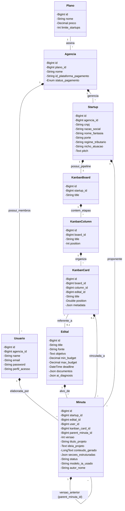
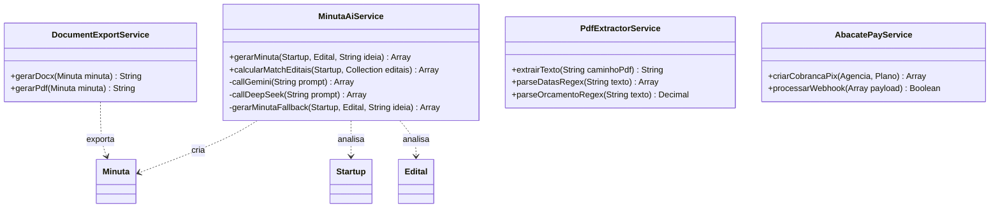
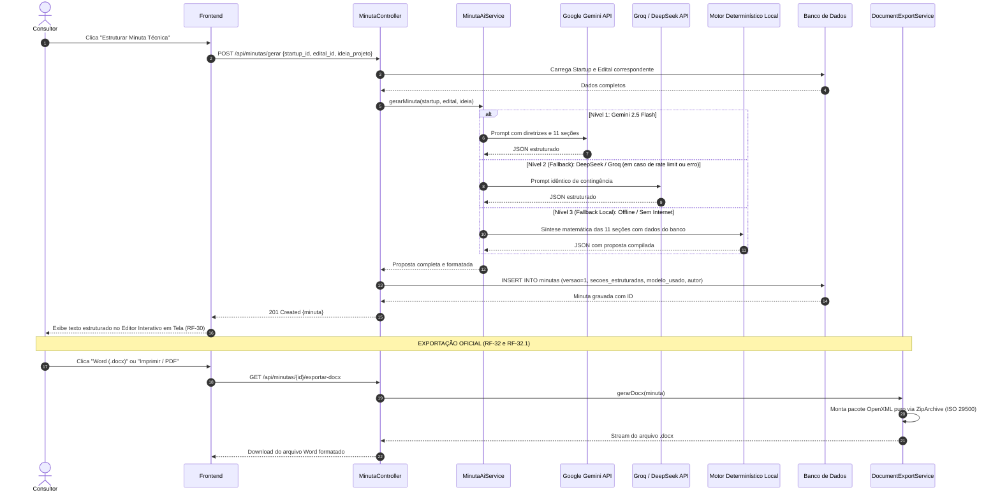

# 📋 Plano Mestre de Alinhamento e Atualização dos Documentos e Artefatos
## Anjo Nexus — Transição da Modelagem Inicial (Fase 1) para a Arquitetura Real Implementada

> **Objetivo Deste Documento:**  
> Registrar formalmente todas as divergências existentes entre a modelagem preliminar (UML, DER, Diagramas de Sequência e Casos de Uso) e a implementação funcional da **Versão Atual** do projeto.  
> Este plano orienta o time de engenharia e os avaliadores acadêmicos sobre:
> 1. Quais inconsistências existem e sua justificativa técnica/acadêmica.
> 2. O passo a passo prático, detalhado e com código pronto para atualizar cada artefato gráfico e textual.
> 3. Como manter os documentos sincronizados com o código para a apresentação da banca.

---

## 📌 Sumário
1. [Diagnóstico Geral: O Motivo das Divergências](#1-diagnóstico-geral)
2. [Matriz Comparativa: Modelagem Teórica vs Código Real](#2-matriz-comparativa)
3. [Justificativas Técnicas e Acadêmicas para a Banca](#3-justificativas-técnicas-e-acadêmicas)
4. [Passo a Passo Detalhado de Atualização de Cada Artefato](#4-passo-a-passo-detalhado-de-atualização)
   - 4.1. [Passo 1: Atualização do Diagrama Entidade-Relacionamento (DER)](#41-passo-1-atualização-do-der)
   - 4.2. [Passo 2: Atualização do Diagrama de Classes (DCL)](#42-passo-2-atualização-do-diagrama-de-classes)
   - 4.3. [Passo 3: Atualização do Diagrama de Sequência de Minutas (DS-08)](#43-passo-3-atualização-do-ds-08-minutas)
   - 4.4. [Passo 4: Atualização do Diagrama de Sequência do Kanban (DS-07)](#44-passo-4-atualização-do-ds-07-kanban)
   - 4.5. [Passo 5: Atualização do Diagrama de Autenticação (DS-01)](#45-passo-5-atualização-do-ds-01-autenticação)
   - 4.6. [Passo 6: Readequação da Especificação de Requisitos](#46-passo-6-readequação-da-especificação-de-requisitos)
5. [Checklist Final de Validação para a Banca](#5-checklist-final-de-validação)

---

## 1. Diagnóstico Geral

No desenvolvimento ágil de software com iterações contínuas (Sprints do Jira), é natural e esperado que o código evolua para atender a restrições reais de APIs de terceiros, performance e custos operacionais que não eram visíveis na fase preliminar de levantamento de requisitos.

No caso do **Anjo Nexus**, os diagramas contidos em `Artefatos - 003` foram elaborados no início do projeto (2º Bimestre), enquanto o código da `Versão Atual` passou por avanços profundos nas Sprints 3, 4 e 5:
- **Evolução de Monousuário para SaaS Multi-tenant:** Introdução do modelo de **Agências** atendendo múltiplas startups.
- **Substituição de Scraping IA por Métodos Determinísticos:** Decisão de Custo Zero (ADR 011) substituindo LLMs caras por XPath e APIs REST internas.
- **Estruturação Oficial de Minutas:** Mudança de um campo HTML plano para 11 seções temáticas padronizadas baseadas nos editais Anjo Inovador/FAPESC e versionamento imutável (ADR 012).

---

## 2. Matriz Comparativa

| Área do Sistema | O Que Consta no Artefato Antigo (`Artefatos - 003`) | O Que Está no Código Real (`MVPs/Versão Atual`) | Ação Necessária na Documentação |
| :--- | :--- | :--- | :--- |
| **Multi-Tenancy** | `Usuario` gerencia diretamente `Startup`. | `Agencia` possui `Planos`, `Usuarios` e `Startups`. | Adicionar a entidade `Agencia` e `Plano` no DER e Diagrama de Classes. |
| **Monetização / SaaS** | Classe `Assinatura` com `mp_pagamento_id` (Mercado Pago). | Integrado com **AbacatePay** na tabela `agencias` (`status_pagamento`). | Atualizar no DER a entidade de Billing vinculada à Agência. |
| **Pipeline Kanban** | `TicketKanban` com `AnexoKanban` e `Minuta` vinculada ao ticket. | `KanbanCard` com posições float e metadados JSON; `Minuta` vinculada a Edital + Startup + Card opcional. | Atualizar nome da classe para `KanbanCard` e ajustar multiplicidade no UML. |
| **Geração de Minutas** | `DS-08`: Streaming via WebSocket com chunks de texto. | Chamada HTTP síncrona com fallback em cascata (Gemini ➔ DeepSeek ➔ Motor Local). | Atualizar o `DS-08` para refletir o fallback de 3 níveis e geração JSON. |
| **Extração de Editais** | "OCR de PDF" com Visão Computacional. | Parse de PDF direto via `smalot/pdfparser` e Regex determinístico de datas e orçamentos. | Renomear `ServicoOcrPdf` para `PdfExtractorService` no DCL e DS-05. |
| **Tags e Requisitos** | Entidades relacionais `Etiqueta` e `RequisitoEdital`. | Dados consolidados em colunas JSON (`documentos`) e atributos textuais diretos. | Indicar no DER que tags são atributos desnormalizados/JSON por performance. |

---

## 3. Justificativas Técnicas e Acadêmicas

Ao ser questionado pela banca examinadora, a equipe deve defender essas alterações utilizando os seguintes argumentos de Engenharia de Software:

### 3.1 Introdução da Entidade `Agencia` (Multi-Tenancy)
* **Justificativa:** No modelo B2B real, consultorias de inovação gerenciam simultaneamente dezenas de startups clientes. A relação direta `Usuario -> Startup` era insuficiente para segregação de faturamento e múltiplos consultores na mesma conta. A adição de `Agencia` estabeleceu a fronteira de Tenant necessária para o SaaS.

### 3.2 Substituição de WebSocket por Fallback em Cascata nas Minutas
* **Justificativa:** O streaming via WebSockets traz alto acoplamento à infraestrutura e fragilidade contra quedas de conexão. A prioridade de engenharia foi garantir **Tolerância a Falhas (Fault Tolerance)**: com a política de 3 níveis (Gemini ➔ DeepSeek ➔ Motor Determinístico Local), a aplicação atinge 100% de disponibilidade mesmo sem internet ou crédito em APIs (ADR 012).

### 3.3 Uso de Regex e Texto Vetorial em vez de OCR
* **Justificativa:** Editais oficiais da administração pública são documentos nato-digitais com texto pesquisável embutido. Aplicar OCR (reconhecimento óptico de caracteres) consumiria tempo de CPU excessivo e introduziria erros de leitura. O uso de Regex sobre texto extraído atendeu ao critério de **Custo Zero e Alta Precisão Jurídica** (ADR 006 e ADR 011).

---

## 4. Passo a Passo Detalhado de Atualização de Cada Artefato

Abaixo está o guia prático, arquivo por arquivo, com o código exato a ser atualizado para refletir a realidade do sistema:

---

### 4.1 Passo 1: Atualização do Diagrama Entidade-Relacionamento (DER)
**Arquivo Alvo:** `Documentação/Artefatos - 003/DIAGRAMA DER DEFINITIVO.mmd`

#### O que precisa ser feito:
1. **Adicionar a entidade `Agencia`** e **`Plano`**.
2. **Remover a ligação direta `Usuario -> Startup`** e ligar através de `Agencia`.
3. **Evoluir a entidade `Minuta`** com auto-relacionamento de versões (`parent_minuta_id`).

#### Código Mermaid Atualizado para Substituir no Arquivo:

---

### 4.2 Passo 2: Atualização do Diagrama de Classes (DCL)
**Arquivo Alvo:** `Documentação/Artefatos - 003/DIAGRAMA DE CLASSE Definitivo.mmd`

#### O que precisa ser feito:
1. Adicionar as classes de serviço que realmente existem no código:
   - `MinutaAiService` (orquestrador de prompt, fallbacks e match de editais).
   - `DocumentExportService` (geração nativa de `.docx` via OpenXML e PDF).
   - `PdfExtractorService` (extração de texto e parsing de datas com Regex).
   - `AbacatePayService` (cobrança e liquidação Pix).
2. Substituir os nomes antigos (`PainelKanban`, `TicketKanban`) por `KanbanBoard` e `KanbanCard`.

#### Trecho de Classes de Serviço a Atualizar:

---

### 4.3 Passo 3: Atualização do Diagrama de Sequência de Minutas (DS-08)
**Arquivo Alvo:** `Documentação/Artefatos - 003/DS-08-MINUTA-IA.mmd`

#### O que precisa ser feito:
- Remover a chamada de WebSockets (que era apenas conceitual) e documentar a **política de contingência em três níveis** com retorno de JSON em 11 seções e versionamento imutável no banco.

#### Código Mermaid Pronto para o `DS-08-MINUTA-IA.mmd`:

---

### 4.4 Passo 4: Atualização do Diagrama de Sequência do Kanban (DS-07)
**Arquivo Alvo:** `Documentação/Artefatos - 003/DS-07-KANBAN.mmd`

#### O que precisa ser feito:
- Substituir as rotas conceituais pelas rotas ativas:
  - Visualizar: `GET /api/kanban`
  - Criar Card: `POST /api/kanban/cards`
  - Mover Card: `PATCH /api/kanban/cards/{id}/mover`
  - Excluir Card: `DELETE /api/kanban/cards/{id}`
- Deixar documentado que upload de arquivos locais é uma evolução da Fase 2.

---

### 4.5 Passo 5: Atualização do Diagrama de Autenticação (DS-01)
**Arquivo Alvo:** `Documentação/Artefatos - 003/DS-01-AUTENTICACAO.mmd`

#### O que precisa ser feito:
- Retirar a referência a JWT puro e especificar o uso de **Laravel Sanctum (Personal Access Tokens)** com Bearer Token.
- Rotas reais: `POST /api/auth/login` e `POST /api/auth/registro`.

---

### 4.6 Passo 6: Readequação da Especificação de Requisitos
**Arquivo Alvo:** `Documentação/Artefatos - 004/ESPECIFICAÇÃO REQUISITOS`

Ajustar a redação formal dos seguintes requisitos:
1. **RF-05 (Extração de Dados do Edital):**
   - *Redação Antiga:* "O sistema deve extrair requisitos usando OCR de PDFs."
   - *Nova Redação Alinhada:* "O sistema deve extrair requisitos, anexos e regras do edital por meio de **parser de texto vetorial e Expressões Regulares (Regex)** estruturadas, garantindo precisão jurídica e custo zero de infraestrutura."
2. **RF-29 (Gerador de Minutas via IA):**
   - *Nova Redação Alinhada:* "O sistema deve sintetizar propostas de inovação via IA estruturadas obrigatoriamente nas **11 seções temáticas oficiais** dos editais de subvenção (Identificação, ODS, Resumo, Problema, Objeto, TRL, Metas, Metodologia, Orçamento/Contrapartida, Riscos e Impactos)."
3. **RF-32 (Exportação Microsoft Word):**
   - *Nova Redação Alinhada:* "O sistema deve exportar a proposta no formato `.docx` por meio de **geração nativa OpenXML (ISO/IEC 29500)** via extensão `ZipArchive` do PHP, dispensando dependências pesadas de terceiros."

---

## 5. Checklist Final de Validação para a Banca

Antes de iniciar a apresentação perante os avaliadores, certifique-se de que:
- [ ] O arquivo `DIAGRAMA DER DEFINITIVO.mmd` possui a entidade `Agencia` e a relação com `Minuta`.
- [ ] O `DIAGRAMA DE CLASSE Definitivo.mmd` lista `MinutaAiService` e `DocumentExportService`.
- [ ] O `DS-08-MINUTA-IA.mmd` demonstra o fallback em 3 níveis (Gemini ➔ DeepSeek ➔ Motor Local).
- [ ] A equipe leu a seção 6 do `MANUAL_DE_ESTUDO_BANCA.md` com as 5 perguntas difíceis e respostas prontas.
- [ ] O arquivo `.gitignore` está ignorando arquivos temporários (`.apk`, `logs`, `.vscode`).
