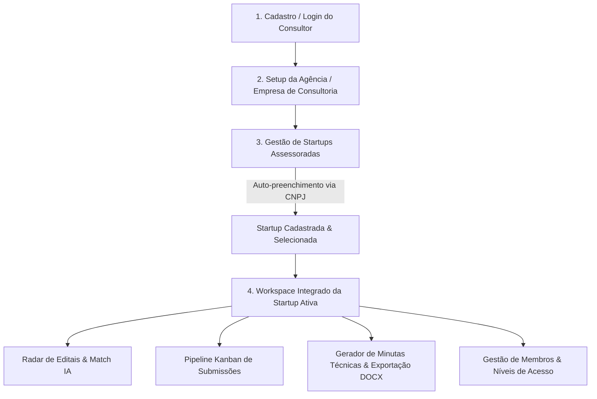

# Plano de Reorganização e Refinamento do Frontend: Experiência B2B & Ciclo Integrado

## 1. Diagnóstico do Estado Atual vs Visão Desejada

### O Problema Atual:
- **Fluxo Fragmentado:** O usuário cai em telas soltas (`login.html` ➔ `cadastrar-startup.html`), sem uma navegação unificada (Header/Sidebar).
- **Cadastro Manual:** O formulário de startup exige preenchimento manual campo a campo, apesar de o backend já possuir a rota de ponta `GET /api/cnpj/{cnpj}` com integração à BrasilAPI e ReceitaWS.
- **Isolamento de Módulos:** O Radar de Editais (`RadarEditais.html`), o Kanban (`kanban.html`) e o Gerador de Minutas operam sem um seletor global da startup ativa que está sendo assessorada.

### A Visão Desejada:
Um **Portal B2B de Assessoria e Consultoria**, fluido, moderno e intuitivo, onde o ciclo operacional faz total sentido:

---

## 2. Estrutura do Novo Ciclo da Interface

### Fase 1: Módulo de Auto-preenchimento via CNPJ (Eliminação do Cadastro Manual)
- **Tecnologia:** Consumo da rota existente `GET /api/cnpj/{cnpj}`.
- **Comportamento na Interface:**
  - O consultor digita o CNPJ no campo com máscara automática (`00.000.000/0000-00`).
  - Ao completar 14 dígitos (ou clicar em **"Buscar Dados da Empresa"**):
    - Mostra um indicador visual de carregamento (`Buscando dados na Receita Federal...`).
    - Preenche instantaneamente: **Razão Social**, **Nome Fantasia**, **Data de Abertura**, **CNAE**, **Endereço Completo (CEP, Rua, Bairro, Cidade, UF)**, **Porte (MEI/ME/EPP)** e **Regime Tributário**.
    - O consultor só precisa complementar o **Nicho de Atuação**, **Nível TRL** e o **Pitch/Resumo Tecnológico**.

---

### Fase 2: Layout Base Unificado (Shell / Workspace com Sidebar e Header)
Em vez de páginas HTML avulsas com layouts desconexos:
1. **Header Global Fixo:**
   - Nome da Empresa de Consultoria (Agência).
   - **Seletor Global de Startup Ativa:** Dropdown no topo mostrando qual startup está sendo assessorada no momento.
   - Perfil do Consultor e botão de Logout.
2. **Sidebar de Navegação Dinâmica:**
   - 🏢 **Minhas Startups:** Listagem, métricas e botão "+ Nova Startup (via CNPJ)".
   - 🎯 **Radar de Editais:** Editais abertos com cálculo de compatibilidade (Match IA) específico para a startup ativa.
   - 📊 **Pipeline Kanban:** Acompanhamento das propostas e editais em andamento da startup ativa.
   - 📝 **Minutas & Propostas:** Histórico de propostas geradas por IA, editor em tela e botão de download em `.docx`.
   - 👥 **Equipe & Acessos:** Gerenciamento de consultores e convites.

---

### Fase 3: Integração Direta Radar ➔ Kanban ➔ Minuta
- **No Radar:** Ao encontrar um edital aderente, o consultor clica em **"Enviar ao Kanban"**:
  - Abre modal rápido confirmando a coluna (ex: *Triagem* ou *Em Elaboração*).
  - O card é criado no Kanban com o edital já vinculado.
- **No Kanban:** O card exibe o botão direto **"Gerar Minuta com IA"**:
  - Dispara o orquestrador com os dados da startup ativa e as diretrizes do edital.
  - Abre a minuta para edição e download no mesmo fluxo visual.

---

### Fase 4: Gestão de Usuários e Níveis de Acesso da Agência
- Gestão de membros associados à `Agencia`:
  - **Consultor Admin:** Acesso total, gerencia faturamento/plano e adiciona membros.
  - **Consultor Padrão:** Assiste startups, opera Radar, Kanban e Minutas.
  - **Cliente (Startup - Somente Leitura):** Acompanha o andamento do pipeline de seus próprios projetos.

---

## 3. Ordem de Execução Recomendada

| Etapa | Ação Técnica | Impacto Visual / UX |
| :--- | :--- | :--- |
| **Passo 1** | Implementar a busca e auto-preenchimento por CNPJ no front (`cadastrar-startup.html` + `cadastrarStartup.js`). | Acaba com a digitação manual de 12 campos. |
| **Passo 2** | Criar componente de cabeçalho com Seletor Global de Startup Ativa compartilhado via `localStorage`. | Dá coerência: o Radar e Kanban sabem qual empresa estão exibindo. |
| **Passo 3** | Conectar botão do Radar ao Kanban (Criar card direto do edital). | Fecha o ciclo comercial da consultoria. |
| **Passo 4** | Polimento estético do formulário de Startup e Kanban com paleta moderna e responsiva. | Interface profissional de alto padrão. |
