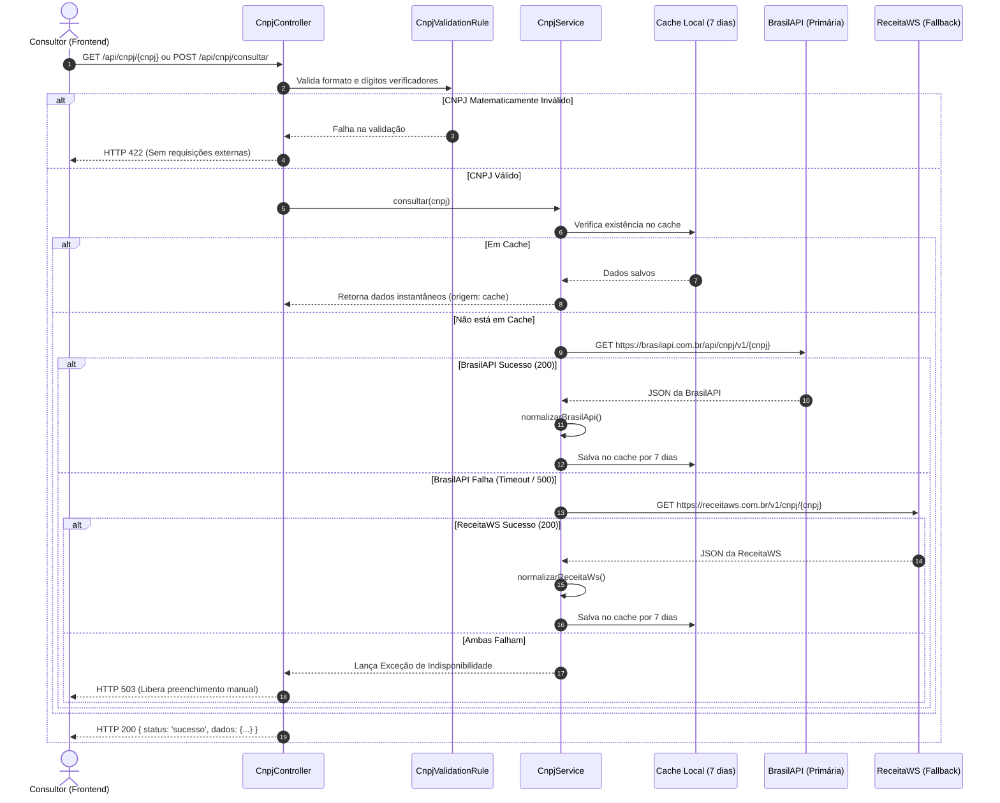

# Guia de Código: Módulo de Busca e Validação de Dados por CNPJ (EDTAN-134)

Este documento detalha a arquitetura, as decisões técnicas, o fluxo de dados e os testes do **Módulo de Busca de Dados de Empresas por CNPJ**, implementado na task **EDTAN-134** (Sprint 6).

---

## 1. Visão Geral e Contexto de Negócio

No ecossistema do **Anjo Nexus**, consultores de inovação gerenciam uma carteira com **múltiplas Startups e Empresas**. O cadastro manual de dados corporativos (Razão Social, CNAE, Porte, Regime Tributário, Endereço e Contato) é lento e suscetível a erros de digitação.

O objetivo do módulo **EDTAN-134** (atendendo aos requisitos **UC-10**, **UC-11** e ao diagrama **DS-03**) é permitir que o consultor informe apenas os 14 dígitos do CNPJ, e o sistema consulte automaticamente as bases oficiais da **Receita Federal**, normalizando e pré-preenchendo todos os campos cadastrais necessários para a tabela `startups` e para os algoritmos de **Match de Editais** e **Geração de Minutas com IA**.

---

## 2. Arquitetura e Fluxo de Execução

O módulo adota uma arquitetura resiliente com **validação matemática preventiva**, **cache local** e **estratégia de fallback entre provedores públicos gratuitos (Custo Zero de API)**:



---

## 3. Detalhamento dos Componentes (Arquivo por Arquivo)

### 3.1. `app/Rules/CnpjValidationRule.php`
Encapsula as regras estritas de validação do Cadastro Nacional da Pessoa Jurídica da Receita Federal do Brasil.

* **Algoritmo Módulo 11:** 
  Calcula os dois dígitos verificadores aplicando as matrizes de pesos oficiais:
  * 1º dígito: pesos `[5, 4, 3, 2, 9, 8, 7, 6, 5, 4, 3, 2]` sobre os primeiros 12 dígitos.
  * 2º dígito: pesos `[6, 5, 4, 3, 2, 9, 8, 7, 6, 5, 4, 3, 2]` sobre os 13 dígitos resultantes.
* **Filtro de Sequências Conhecidas:** Rejeita padrões repetidos (`00000000000000`, `11111111111111`, etc.) que passariam na fórmula matemática mas são inválidos na Receita.
* **Métodos Utilitários:**
  * `CnpjValidationRule::sanitize(?string $cnpj): string` — Remove pontos, barras, hifens e espaços em branco.
  * `CnpjValidationRule::format(string $cnpj): string` — Converte `34406665000111` em `34.406.665/0001-11`.
  * `CnpjValidationRule::isValid(string $cnpj): bool` — Avaliação booleana direta sem necessidade de instanciar o validador do Laravel.

### 3.2. `app/Services/CnpjService.php`
Centraliza a lógica de integração, tratamento de contingências e mapeamento de dados.

* **Princípio de Alta Disponibilidade (Fallback em Cascata):**
  1. **BrasilAPI (`https://brasilapi.com.br/api/cnpj/v1/{cnpj}`):** Rápida, gratuita e mantida pela comunidade open-source brasileira.
  2. **ReceitaWS (`https://receitaws.com.br/v1/cnpj/{cnpj}`):** Acionada imediatamente caso a BrasilAPI retorne status 5xx ou timeout de 8 segundos.
* **Resiliência de Cache:**
  * As consultas bem-sucedidas são gravadas por **7 dias** (`Cache::put()`).
  * As operações de cache são envolvidas em blocos `try/catch (\Throwable $e)`. Se o banco de dados MySQL ou Redis estiver offline ou inacessível no momento, o serviço **não quebra**: ele ignora a falha do cache e realiza a consulta externa normalmente.
* **Padronização de Porte:** Normaliza variações textuais para o padrão da plataforma: `Microempresa (ME)`, `Empresa de Pequeno Porte (EPP)`, `Médio Porte`, `Grande Porte` ou `Demais`.
* **Sub-payload `startup_payload`:** Retorna um objeto pronto para ser repassado diretamente para `Startup::create($dados['startup_payload'])`.

### 3.3. `app/Exceptions/CnpjNotFoundException.php`
Exceção semântica de domínio disparada quando a API da Receita Federal responde que o CNPJ pesquisado não existe nos registros cadastrais, mapeada diretamente para o código HTTP `404 Not Found`.

### 3.4. `app/Http/Controllers/CnpjController.php`
Expõe a interface REST para consumo do frontend e integrações externas.

* **Métodos:**
  * `consultar(Request $request, string $cnpj): JsonResponse` (Via GET)
  * `consultarPost(Request $request): JsonResponse` (Via POST com Form Validation)
* **Parâmetro Opcional `refresh`:** Ao enviar `?refresh=true` (ou `{"refresh": true}`), o serviço ignora o cache local e busca os dados atualizados em tempo real na Receita.

### 3.5. `routes/api.php`
Rotas registradas no grupo `/api/cnpj`:
```php
Route::prefix('cnpj')->group(function () {
    Route::get('/{cnpj}', [CnpjController::class, 'consultar']);
    Route::post('/consultar', [CnpjController::class, 'consultarPost']);
});
```

---

## 4. Contrato da API e Estrutura da Resposta

### Exemplo de Requisição:
`GET /api/cnpj/06.990.590/0001-23` ou `GET /api/cnpj/06990590000123`

### Resposta de Sucesso (`HTTP 200 OK`):
```json
{
  "status": "sucesso",
  "mensagem": "Dados da empresa obtidos com sucesso na Receita Federal.",
  "dados": {
    "provedor": "brasilapi",
    "cnpj": "06990590000123",
    "cnpj_formatado": "06.990.590/0001-23",
    "razao_social": "GOOGLE BRASIL INTERNET LTDA.",
    "nome_fantasia": "GOOGLE BRASIL",
    "data_abertura": "2004-10-27",
    "situacao_cadastral": "ATIVA",
    "porte": "Demais",
    "regime_tributario": "Lucro Presumido / Real",
    "cnae_codigo": "6319400",
    "cnae_descricao": "Portais, provedores de conteúdo e outros serviços de informação na internet",
    "nicho_atuacao": "Portais, provedores de conteúdo e outros serviços de informação na internet",
    "natureza_juridica": "206-2 - Sociedade Empresária Limitada",
    "endereco": {
      "cep": "04538133",
      "logradouro": "AVENIDA BRIGADEIRO FARIA LIMA",
      "numero": "3477",
      "complemento": "ANDAR 18 E 20",
      "bairro": "ITAIM BIBI",
      "cidade": "SAO PAULO",
      "estado": "SP"
    },
    "contato": {
      "email": "googlebrasil@google.com",
      "telefone": "(11) 2395-8400"
    },
    "socios": [
      { "nome": "GOOGLE LLC", "qualificacao": "Sócio Pessoa Jurídica Domiciliado no Exterior" }
    ],
    "startup_payload": {
      "cnpj": "06.990.590/0001-23",
      "razao_social": "GOOGLE BRASIL INTERNET LTDA.",
      "nome_fantasia": "GOOGLE BRASIL",
      "data_abertura": "2004-10-27",
      "email": "googlebrasil@google.com",
      "telefone": "(11) 2395-8400",
      "cep": "04538133",
      "logradouro": "AVENIDA BRIGADEIRO FARIA LIMA",
      "numero": "3477",
      "bairro": "ITAIM BIBI",
      "cidade": "SAO PAULO",
      "estado": "SP",
      "porte": "Demais",
      "regime_tributario": "Lucro Presumido / Real",
      "nicho_atuacao": "Portais, provedores de conteúdo e outros serviços de informação na internet"
    }
  }
}
```

---

## 5. Bateria de Testes Automatizados

O módulo possui testes unitários e de integração implementados com PHPUnit e SQLite em memória.

### 5.1. Testes Unitários (`tests/Unit/CnpjValidationRuleTest.php`)
1. `test_valida_cnpjs_corretos`: Valida CNPJs autênticos conhecidos com e sem máscara (Petrobras, Google, Banco do Brasil, etc.).
2. `test_rejeita_cnpjs_com_digitos_verificadores_incorretos`: Garante rejeição quando o último dígito é adulterado.
3. `test_rejeita_cnpjs_com_digitos_repetidos`: Rejeita `11.111.111/1111-11`, etc.
4. `test_rejeita_comprimento_invalido`: Rejeita strings com menos ou mais de 14 dígitos.
5. `test_sanitiza_corretamente`: Verifica a limpeza de caracteres especiais.
6. `test_formata_cnpj`: Verifica a montagem correta da máscara visual.

### 5.2. Testes de Feature (`tests/Feature/CnpjApiTest.php`)
1. `test_consulta_cnpj_sucesso_via_brasilapi`: Mock da BrasilAPI testando normalização e status 200.
2. `test_fallback_automatico_para_receitaws_quando_brasilapi_falhar`: Simula erro 500 na BrasilAPI e valida recuperação bem-sucedida via ReceitaWS.
3. `test_rejeita_cnpj_matematicamente_invalido_sem_chamar_api_externa`: Assegura via `Http::assertNothingSent()` que nenhum tráfego externo é gerado para CNPJs com dígitos inválidos (retorno 422).
4. `test_retorna_404_quando_cnpj_nao_encontrado_na_receita`: Testa retorno 404 quando o CNPJ não existe na base cadastral.
5. `test_consulta_via_post_com_validacao_de_payload`: Valida endpoint POST e mensagens de erro do validador.
6. `test_segunda_consulta_utiliza_cache_sem_chamada_http`: Valida que a segunda chamada consecutiva é lida do cache e não dispara requisição HTTP externa (`Http::assertSentCount(1)`).

### Como Executar os Testes:
```bash
php artisan test --filter=Cnpj
```
*Resultado:* **12 testes aprovados, 45 asserções, 0 falhas.**

---

## 6. Exemplo de Integração no Frontend (JavaScript)

Para consumir o módulo na tela de cadastro de startups:

```javascript
async function buscarCnpj(cnpjInformado) {
    const cnpjLimpo = cnpjInformado.replace(/\D/g, '');
    
    if (cnpjLimpo.length !== 14) {
        alert('Por favor, digite um CNPJ completo com 14 dígitos.');
        return;
    }

    try {
        const response = await fetch(`http://127.0.0.1:8000/api/cnpj/${cnpjLimpo}`, {
            headers: { 'Accept': 'application/json' }
        });
        
        const data = await response.json();

        if (response.ok) {
            const emp = data.dados;
            // Preenche automaticamente os inputs do formulário
            document.getElementById('razao_social').value = emp.razao_social;
            document.getElementById('nome_fantasia').value = emp.nome_fantasia;
            document.getElementById('cidade').value = emp.endereco.cidade;
            document.getElementById('estado').value = emp.endereco.estado;
            document.getElementById('nicho_atuacao').value = emp.nicho_atuacao;
            document.getElementById('porte').value = emp.porte;
            document.getElementById('regime_tributario').value = emp.regime_tributario;
        } else {
            alert('Atenção: ' + data.mensagem);
        }
    } catch (error) {
        console.error('Erro de conexão:', error);
        alert('Não foi possível conectar à API de CNPJ. Por favor, preencha manualmente.');
    }
}
```
